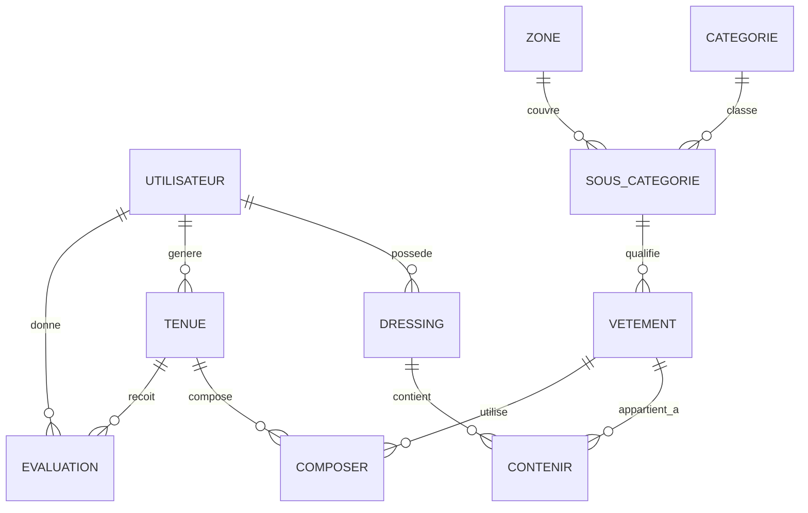

# FITS — C4 : schéma et requêtes PostgreSQL

**Conclusion :** PostgreSQL est adapté au cœur métier et au dataset ML actuels. Les clés relationnelles protègent la composition des tenues et des avis ; les requêtes lues sur cette petite base sont rapides. Aucun index ni changement de schéma n'est justifié **avant l'oral** par les mesures présentes.

## Modèle relationnel réellement observé

Le code Sequelize (`backend/models`) a été confronté aux catalogues de la base locale `fits` avec `backend/scripts/diagnosePostgres.js`. La mesure du 13/10/2026 porte sur PostgreSQL **14.20 Homebrew**, `::1`, dans une transaction `REPEATABLE READ READ ONLY`. Le schéma simplifié suivant reflète les clés étrangères effectivement présentes ; les cardinalités dessinées expriment ce que **la base autorise**, pas l'intention métier.



**Clés et intégrité.** Chaque entité principale a une clé primaire entière ; `contenir(id_dressing,id_vetement)`, `composer(id_tenue,id_vetement)` et `evaluation(id_utilisateur,id_tenue)` ont des clés composées. `utilisateur.email` et `zone.nom_zone` sont uniques. Les clés étrangères existent pour toutes les arêtes ci-dessus. Les liens utilisateur → dressing/tenue/avis et tenue → composition/avis sont supprimés en cascade ; les références aux vêtements sont restrictives. Le PK de `evaluation` empêche deux avis du même utilisateur sur la même tenue : un nouvel avis passe par `upsert`.

**Points que la base ne garantit pas.** Elle n'impose pas l'unicité de `dressing.id_utilisateur` ; `findOne` suppose pourtant un dressing par utilisateur. Les deux clés étrangères de `evaluation` ne garantissent pas à elles seules que la tenue appartient à l'utilisateur qui vote : le contrôleur vérifie cette propriété avant écriture. Rien dans `composer` ne garantit que les vêtements d'une tenue appartiennent au même utilisateur ; la logique applicative le détermine à la génération. Ces limites sont importantes pour expliquer la répartition des responsabilités entre SQL et Node.

`evaluation.feature_snapshot` est un **JSONB nullable**. Les nouveaux votes y conservent une version et la liste des attributs de vêtements au moment de l'avis ; le dataset ML peut ainsi utiliser un état figé sans créer de tables historiques complexes. Sur 69 avis, seuls **trois snapshots sont valides** ; les 66 autres utilisent, si possible, les vêtements courants. Le JSONB apporte cette souplesse mais n'a pas ici d'index dédié ni de validation structurelle SQL. `outfit-v2` transforme ensuite les données en colonnes numériques pour Python ; MongoDB ne sert pas à cette étape.

**Écarts Sequelize / PostgreSQL mesurés.** `evaluation.temperature`, `tenue.temperature` et `vetement.id_sous_categorie` sont nullable en SQL alors que leurs modèles Sequelize déclarent `allowNull: false`. Cinq anciens avis ont effectivement une température nulle et sont exclus du dataset. Le code doit donc conserver ses contrôles de qualité ; changer la nullabilité ou corriger l'historique exigerait une migration et une décision distinctes. La colonne JSONB de la migration `20261013_add_evaluation_feature_snapshot.sql` est présente ; aucun registre de migrations appliquées n'a été trouvé dans le dépôt.

## Volume, index et plans mesurés

La base entière occupe **9,38 Mio**. Les tables les plus actives du parcours sont `tenue` (**271 lignes**), `composer` (**1 709**) et `evaluation` (**69**). Les dix tables métier occupent ensemble **624 Kio** avec index et éventuel TOAST. Les index observés proviennent exclusivement des clés primaires et contraintes uniques. Les préfixes des PK `(id_utilisateur,id_tenue)`, `(id_tenue,id_vetement)` et `(id_dressing,id_vetement)` peuvent servir les accès par utilisateur, tenue et dressing. Aucun index secondaire n'existe sur `tenue.id_utilisateur` ni `dressing.id_utilisateur`.

La mesure suivante utilise **cinq `EXPLAIN (ANALYZE, BUFFERS, FORMAT JSON)` par `SELECT`**, même paramètre choisi dans les données existantes sans l'afficher. Le script impose `statement_timeout = 2s`, `lock_timeout = 500ms` et une transaction `READ ONLY`. Les chiffres sont les **médianes côté serveur** de la seconde lecture du 13/10/2026, sur cache local probablement chaud ; ils excluent Sequelize, le réseau, la préparation des features et la génération complète.

| Lecture critique | Lignes de la table principale | Médiane sur cinq exécutions | Nœuds principaux du plan |
|---|---:|---:|---|
| Avis d'un utilisateur, pour le dataset | 69 | **0,017 ms** | `Seq Scan` sur `evaluation` |
| Tenues d'un utilisateur | 271 | **0,049 ms** | `Seq Scan` sur `tenue` |
| Dressing d'un utilisateur | 6 | **0,005 ms** | `Limit` + `Seq Scan` |
| Vêtements d'un dressing | 16 liens, 22 vêtements | **0,031 ms** | PK de `contenir` via bitmap, `Hash Join`, `Seq Scan` sur `vetement` |
| Vêtements d'une tenue | 1 709 liens au total | **0,007 ms** | PK de `composer` via bitmap |

Un `Seq Scan` sur 6, 69 ou 271 lignes peut être **le meilleur plan** : son existence ne prouve pas un goulet d'étranglement. La requête sur `evaluation` choisit ainsi un parcours séquentiel malgré l'index PK dont `id_utilisateur` est la première colonne. Les tailles et temps observés ne motivent pas la création immédiate de `tenue(id_utilisateur)` ou `dressing(id_utilisateur)`. Le premier serait à réévaluer si `tenue` croît fortement et si les recherches par utilisateur deviennent coûteuses ; le second pourrait être **unique** seulement après validation de la règle métier « un dressing par utilisateur » et contrôle des doublons. Tout essai d'index devrait être fait sur une base **isolée**, avec plans et temps avant/après et prise en compte de son coût en écriture et stockage. Aucun index n'a été créé ici.

Le dataset complet a été préparé trois fois par l'export privé existant : **19,303 / 16,367 / 14,701 ms** pour `loadFeatureSchema` et `buildTrainingDataset` de 64 lignes, médiane **16,367 ms**. Cela inclut plusieurs lectures ORM et transformations Node, mais exclut ouverture de connexion, sortie JSON, entraînement et transfert vers Python. Le code effectue plusieurs lectures en lot (`Evaluation`, `Tenue`, `Composer`, `Vetement`) plutôt qu'une requête par avis ; les jointures du plan ci-dessus sont un **échantillon du chemin**, pas une mesure de chaque requête Sequelize réelle. La génération complète n'a pas été chronométrée, car elle écrit une tenue et ses compositions.

## Reproduction sans écriture

```sh
cd '/Users/kojiro/Documents/Cours Dev/fits/backend'
node scripts/diagnosePostgres.js
node scripts/reportEvaluationQuality.js
```

Le diagnostic vérifie `DB_HOST` local, `DB_NAME=fits`, `NODE_ENV` hors production et l'adresse réelle du serveur ; il n'affiche aucun ID, e-mail ni ligne d'avis. Il inventorie lignes, tailles, colonnes, contraintes, index, activité agrégée et plans. Il exécute uniquement des `SELECT` et des `EXPLAIN ANALYZE` portant sur des `SELECT`, puis termine par `ROLLBACK`. Le test `backend/tests/diagnosticScripts.test.js` vérifie les garde-fous et le refus d'expliquer une écriture. La procédure privée d'export et de mesure du dataset est détaillée dans `ANALYSE_BIG_DATA.md` et `DEMO_ML.md`.

**Pour le PowerPoint :** montrer le schéma relationnel ci-dessus et une seule ligne du plan `evaluation` : « 69 avis, 0,017 ms, séquentiel optimal à cette taille ». Questions probables : « Pourquoi PostgreSQL ? » — intégrité des relations, unicité des avis et transactions ; « Pourquoi JSONB ? » — figer des attributs évolutifs sans éclater l'historique ; « Pourquoi pas d'index supplémentaire ? » — aucun gain mesuré à la volumétrie actuelle et tout index coûte espace et écritures ; « La FK garantit-elle la propriété de la tenue évaluée ? » — non, le contrôle applicatif reste nécessaire.
