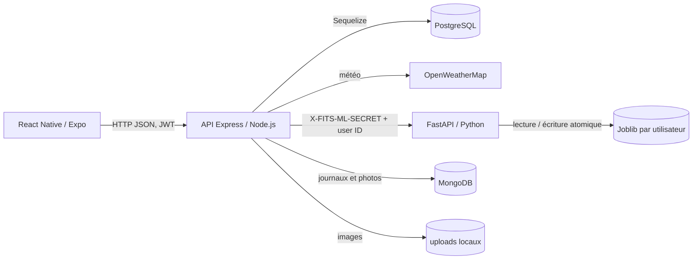

# FITS — Audit du bloc 4 Big Data & IA

Audit du 13 octobre 2026. Périmètre : dépôt FITS, tests isolés, catalogues et comptes agrégés de la base locale `fits` consultés **en lecture seule**, et deux appels de prédiction au backend local déjà démarré. Aucun entraînement de service, changement PostgreSQL ou remplacement Joblib n'a été effectué. La grille officielle n'est pas présente dans le dépôt : les intitulés C1 à C5 ci-dessous proviennent de la mission transmise, **pas d'une citation certifiée du référentiel**. RNCP36286 et RNCP40573 désignent deux références différentes ; leur correspondance avec BC04B doit être confirmée auprès de l'établissement avant l'oral.

Le corps de cet audit décrit l'état **avant la première phase d'amélioration validée ensuite**. Les corrections et mesures nouvelles figurent dans l'addendum en fin de document et dans `SECURITE_UPLOADS.md`, `PERFORMANCES_ML.md` et `QUALITE_DONNEES.md`.

## Échelle de preuve

- **Absent** : aucun mécanisme trouvé dans le dépôt inspecté.
- **Présent mais non testé** : code identifié, sans vérification ciblée réussie.
- **Testé** : test automatisé isolé exécuté et réussi.
- **Démontré localement** : comportement observé sur les services ou la base locale ; cela ne constitue ni une validation en production ni une démonstration déjà faite au jury.

Les tests exécutés pour cet audit : 83 tests backend (dont l'intégration Node/Python avec mocks et fichiers temporaires), 16 tests Python et 11 tests de l'écran mobile, tous réussis. `backend/tests/fits.test.js` a été exclu car il crée des utilisateurs et vêtements dans la base de développement. Le test mobile exige Jest ; `node --test` seul ne convient pas. Aucun document de déploiement reproductible ou manifeste de dépendances Python épinglées n'a été trouvé.

## Architecture et parcours réel

Le dépôt contient inscription/connexion, profil, dressing et vêtements, météo, génération/évaluation des tenues, administration et deux chemins d'upload photo (`backend/app.js:18-46`, écrans dans `mobile/src/screens/`). Le mobile appelle `generateTenue` puis `evaluateTenue` (`mobile/src/screens/home.js:45-94`, `mobile/src/services/api.js:63-116`). La génération filtre les vêtements par température, crée au plus cinq candidats aléatoires et choisit le score ML maximal (`backend/controllers/tenueController.js:37-115`). L'avis est validé, associé à une tenue appartenant à l'utilisateur, enregistré avec un snapshot puis déclenche un réentraînement via l'API Node (`backend/controllers/evaluationController.js:10-78`). `buildTrainingDataset` assemble les lignes par utilisateur (`backend/services/trainingDataset.js:15-83`) avec le même encodeur que la prédiction (`backend/services/outfitFeatures.js:44-140`). Le service Python entraîne et recharge un Random Forest propre à l'utilisateur (`ml-service/app.py:79-163`).

Une vérification locale en lecture seule a confirmé : un fichier de modèle personnalisé dans le répertoire par défaut, HTTP 200 avec `model_used: personalized` pour ce modèle, puis HTTP 200 avec `model_used: fallback`, `reason: no_model` pour un identifiant de contrôle sans modèle. Le précédent constat « toujours no_model » n'est donc **plus vrai pour l'utilisateur modélisé** ; le fallback reste nécessaire pour les autres. Cette sonde a utilisé des JWT courts créés localement et des features artificielles ; elle ne teste ni la connexion depuis le mobile ni la pertinence des recommandations.

**Dépendances et commandes repérées.** `backend/package.json` prévoit `npm run dev`, `npm start` et `npm test` (Express, Sequelize, `pg`, Mongoose, Axios, Jest). `mobile/package.json` prévoit `npm start`, `npm run ios/android/web` et `npm run lint` (Expo/React Native), mais aucun script `test`. `ml-service/app.py` utilise FastAPI, pandas, scikit-learn et Joblib ; le dépôt ne contient ni `requirements.txt` ni `pyproject.toml`. Les tests Python se lancent avec `PYTHONDONTWRITEBYTECODE=1 /opt/anaconda3/bin/python3 -m unittest discover -s tests -v` depuis `ml-service`. Le test mobile a été lancé depuis `mobile` avec `../backend/node_modules/.bin/jest --runInBand tests/home.test.js`. Les tests backend sûrs ont été lancés depuis `backend` avec `ML_TEST_PYTHON=/opt/anaconda3/bin/python3 npm test -- --runInBand --testPathIgnorePatterns=tests/fits.test.js`.

## C1 — Analyse Big Data

| Point demandé | État et preuve |
|---|---|
| Sources | **Testé / démontré localement** : utilisateurs, vêtements, catégories, zones, tenues et avis en PostgreSQL (`backend/models/*.js`) ; météo via `backend/services/meteo.js:5-18` ; images locales ou MongoDB et journaux MongoDB via `backend/routes/uploadRoutes.js:5-20`, `backend/controllers/photoController.js:3-25` et `backend/utils/logger.js:3-13`. |
| Volume | **Démontré localement** par comptages agrégés au 13/10/2026 : 6 utilisateurs, 22 vêtements, 271 tenues, 69 évaluations (44 likes, 25 dislikes). Les 69 avis concernent un seul utilisateur ; aucun volume Big Data n'est établi. |
| Variété | **Présent mais non testé de bout en bout** : tables relationnelles, snapshots JSONB (`backend/models/evaluation.js:28-31`), réponses météo JSON et images. Le modèle n'utilise que les features tabulaires issues des vêtements, de la température et des avis. |
| Vélocité | **Présent mais non mesuré** : un avis provoque un réentraînement synchrone (`backend/controllers/evaluationController.js:63-76`) ; pas de flux continu, de traitement distribué ni de volume/latence instrumentés. |
| Besoin métier | **Présent mais non validé auprès d'utilisateurs** : proposer une tenue adaptée à la température et aux préférences exprimées ; cinq candidats sont classés par score de like (`backend/controllers/tenueController.js:47-95`). |

**Partiel / manquant.** Pas de mesure de croissance, latence, débit, coût ou capacité. Les photos et journaux sont des sources de données, pas des variables du Random Forest. La notion de « Big Data » relève ici de l'analyse des contraintes et d'une trajectoire éventuelle de montée en charge, pas de la volumétrie observée.

**Risque soutenance : haute.** Une affirmation de traitement Big Data à grande échelle serait contredite par les chiffres. Présenter 3V avec mesures honnêtes, puis expliquer le besoin futur d'indexation, de tâches d'entraînement asynchrones et d'observabilité avant toute montée en charge.

**Priorité : haute. Preuve à montrer :** schéma des sources ci-dessus, requête d'agrégats en lecture seule et exemple du classement de cinq candidats dans `tenueController.js`.

## C2 — Machine Learning

| Point demandé | État et preuve |
|---|---|
| Modèle réel | **Testé et démontré localement** : `RandomForestClassifier(random_state=42)` entraîné par utilisateur après seuils configurables de 20 avis et 5 par classe (`ml-service/app.py:79-124`). Un modèle personnalisé a été chargé par `/predict` lors de la sonde locale. |
| Dataset et variables | **Testé** : `temperature`, nombre et proportion de favoris, indicateurs zone, couleur, catégories et associations (`backend/services/outfitFeatures.js:91-140`) ; avis explicites `is_liked` (`backend/services/trainingDataset.js:64-80`). Les colonnes sont identiques à la prédiction grâce à l'encodeur commun et au contrôle `feature_version`. |
| Sauvegarde / chargement | **Testé** : fichiers `user_<id>.joblib`, écriture temporaire puis remplacement atomique, version et catalogue enregistrés (`ml-service/app.py:106-122, 135-163`). L'ancien `model.joblib` partagé reste présent mais n'est pas utilisé. |
| Séparation et baseline | **Testé hors ligne**, pas intégré à `/train` : `ml-service/evaluate.py:69-147` sépare par tenue si besoin, stratifie les classes et compare à `DummyClassifier(strategy="most_frequent")`. Pas de jeu de validation distinct, de validation temporelle ni de comparaison répétée sur plusieurs découpages. |
| Inférence et fallback | **Testé et démontré localement** : `probability_like`, `model_used` et `reason` à `/predict` (`ml-service/app.py:127-163`) ; un utilisateur sans modèle reçoit `ratio_favoris` en fallback. Le moteur de génération exploite le score mais ne renvoie pas `model_used` au mobile. |

**Résultat réel local, non généralisable.** Export privé temporaire puis évaluation hors ligne du seul utilisateur disposant d'avis : 69 avis bruts, 64 exploitables, 42 likes et 22 dislikes. Séparation stratifiée 48 entraînement / 16 test, graine 42, 64 tenues distinctes. Random Forest : accuracy **0,375**, précision like **0,500**, rappel like **0,500**, F1 like **0,500**, matrice `[[1,5],[5,5]]`. Baseline majoritaire : accuracy **0,625**, précision **0,625**, rappel **1,000**, F1 **0,769**, matrice `[[0,6],[0,10]]` ; ordre des classes : dislike, like. Le modèle fait donc **moins bien que la baseline sur ce test**. Le fichier d'export contenant les préférences a été supprimé après la mesure. `ml-service/examples/evaluation_synthetique.md` est une démonstration **fictive**, jamais une preuve de performance réelle.

**Partiel / manquant.** Le seuil d'entraînement ne garantit pas une amélioration mesurée ; `/train` utilise tous les avis disponibles et sauvegarde sans validation préalable contre la baseline. La mesure réelle repose sur seulement 16 avis de test et un seul découpage. Les anciens avis sans snapshot peuvent refléter l'état actuel des vêtements ; différentes tenues peuvent partager des vêtements. Les métriques binaires ne mesurent pas directement la qualité du classement des cinq candidats. Le choix du Random Forest est plausible pour des features tabulaires mixtes et des interactions non linéaires, mais **aucune supériorité empirique n'est démontrée ici**.

**Risque soutenance : critique.** Ne pas annoncer une amélioration des recommandations par l'IA. Montrer le vrai score, la baseline, la petite taille de test et expliquer pourquoi le système conserve un fallback. Ne pas modifier le modèle par intuition avant d'avoir davantage d'avis et une évaluation plus robuste.

**Priorité : critique. Preuve à montrer :** `app.py`, `outfitFeatures.js`, `evaluate.py`, résultats chiffrés ci-dessus et réponse locale `model_used: personalized`/`fallback` sans données personnelles.

## C3 — Traitement des données / ETL

| Point demandé | État et preuve |
|---|---|
| Extraction | **Testé** : `Evaluation.findAll({where:{id_utilisateur}})` puis vérification de propriété des tenues et chargement des compositions/vêtements (`backend/services/trainingDataset.js:15-61`). |
| Nettoyage | **Testé** : rejet des avis incomplets, température incohérente, tenue étrangère ou composition inutilisable (`trainingDataset.js:20-80`). Sur la base locale, 5 avis ont une température nulle et sont exclus ; 64/69 deviennent des lignes ML. |
| Valeurs manquantes / transformations | **Testé** : buckets `autre`/`inconnu` pour couleurs et catégories, ratios sans division par zéro, vocabulaire normalisé et versionné (`backend/services/outfitFeatures.js:20-140`). Aucun mécanisme de correction documenté pour les températures nulles historiques. |
| Snapshot au moment de l'avis | **Présent et testé**, mais couverture limitée : `feature_snapshot` est bien une colonne JSONB nullable dans la base locale et seulement 3 des 69 avis en possèdent un valide (`backend/controllers/evaluationController.js:32-60`, migration SQL). Les autres utilisent l'état **actuel** des vêtements (`trainingDataset.js:69-76`). |
| Reproductibilité / qualité | **Partiel** : empreinte SHA-256 du catalogue de features `outfit-v2`, seed 42 et tests ; pas de manifeste de versions Python, de rapport automatisé de taux d'exclusion ni de traçabilité d'un export réel dans le dépôt. |
| Données personnelles | **Partiel** : secret `.env` ignoré, modèles personnalisés ignorés, export d'évaluation hors Git en mode 0600 (`backend/scripts/exportEvaluationDataset.js:13-42`). En revanche, l'inscription/journalisation stocke e-mail et IP dans MongoDB (`backend/controllers/authController.js:30-34, 49-73`), 17 fichiers `backend/uploads/` sont suivis par Git, et `deleteMe` ne supprime explicitement ni Joblib, ni journaux Mongo, ni images (`backend/controllers/utilisateurController.js:39-49`). |

**Risque soutenance : haute.** Les 66 avis sans snapshot valide fragilisent l'interprétation causale des features, et l'absence d'inventaire de conservation des données rend la réponse RGPD incomplète. Ne pas déclarer la conformité RGPD sans analyse dédiée ; inventorier les données, finalités, durées, accès et suppression.

**Priorité : haute. Preuve à montrer :** un schéma `source → contrôles → snapshot/état actuel → features → modèle`, les 5 exclusions observées, les tests `backend/tests/trainingDataset.test.js` et le caractère privé de l'export.

## C4 — Bases de données

**État : démontré localement pour le schéma actuel.** PostgreSQL 14.20 Homebrew, base `fits` sur `::1:5432`. Tables centrales `utilisateur`, `dressing`, `contenir`, `vetement`, `categorie`, `sous_categorie`, `zone`, `tenue`, `composer`, `evaluation` (`backend/models/*.js`). Le catalogue confirme les clés primaires, la clé composite `(id_utilisateur,id_tenue)` de `evaluation`, l'unicité de `utilisateur.email` et de `zone.nom_zone`, ainsi que les clés étrangères entre utilisateur/tenue/avis, tenue/composition/vêtement et dressing/contenu. Les suppressions d'utilisateur ou de tenue propagent des cascades sur certaines relations ; les liens vers les vêtements sont restrictifs.

**Index constatés :** clés primaires et contraintes uniques seulement. L'index `evaluation_pkey(id_utilisateur,id_tenue)` sert la lecture des avis par utilisateur ; `composer_pkey(id_tenue,id_vetement)` sert les compositions. Aucun index secondaire sur `tenue.id_utilisateur` ni `dressing.id_utilisateur` n'a été observé. Il n'y a pas de contrainte unique sur `dressing.id_utilisateur`. À l'échelle actuelle, aucune lenteur n'a été mesurée ; `EXPLAIN ANALYZE` et des mesures sont requis avant d'ajouter des index.

**Écart modèle/base :** `evaluation.temperature` est nullable dans PostgreSQL mais `allowNull: false` dans `backend/models/evaluation.js:23-26` ; cinq lignes historiques nulles sont exclues du ML. `tenue.temperature`, `vetement.id_sous_categorie` et `vetement.favori` présentent également une nullabilité réelle plus permissive que celle attendue par une partie du code. La migration `backend/migrations/20261013_add_evaluation_feature_snapshot.sql` est présente dans le dépôt et sa colonne est observée en base ; le dépôt ne contient pas de suivi formel des migrations appliquées.

**Partiel / manquant.** Pas de mesure des plans d'exécution ni des temps de requête ML, pas de stratégie analytique au-delà des requêtes applicatives. Le schéma convient à ce prototype relationnel ; une base Big Data distribuée n'est pas justifiée par 69 avis.

**Risque soutenance : moyenne. Priorité : moyenne. Preuve à montrer :** diagramme relationnel dérivé des clés réellement observées, index et exemple de requête `evaluation` filtrée par utilisateur. Toute correction de schéma demanderait une migration testée et une sauvegarde, après validation séparée.

## C5 — Architecture et intégration IA

| Point demandé | État et preuve |
|---|---|
| Contrats et isolation | **Testé / démontré localement** : `/api/ml/train` et `/api/ml/predict` exigent le JWT (`backend/routes/mlRoutes.js:6-7`), Node transmet l'ID authentifié et le secret partagé (`backend/services/mlClient.js:3-19`), FastAPI vérifie les deux en-têtes (`ml-service/app.py:47-62`). Secret configuré côté backend local, valeur non lue ni reproduite dans cet audit. |
| Séparation métier/ML | **Présent** : règles de génération dans `tenueController.js`, préparation des features dans `outfitFeatures.js`, apprentissage et inférence dans `ml-service/app.py`. Un appel HTTP interne depuis `evaluationController.js:63-76` couple toutefois l'enregistrement d'avis au réentraînement synchrone. |
| Erreurs / dégradation | **Partiel** : FastAPI gère l'absence et l'incompatibilité de modèle par fallback ; une panne ou lenteur du service ML fait échouer la génération Node (`tenueController.js:80-120`, `mlClient.js:13-19`), sans timeout explicite sur l'appel Axios. Le réentraînement échoué est masqué comme non bloquant pour l'avis. |
| Traçabilité | **Partiel** : `/predict` expose `model_used` et `reason`, mais la génération ne conserve ni ne renvoie cette information (`tenueController.js:88-116`). Aucun historique des scores/versions par tenue n'a été trouvé. |
| Tests d'intégration | **Testé** : parcours simulé complet `backend/tests/mlJourney.integration.test.js:36-228`, isolation des modèles et fallback `ml-service/tests/test_app.py`, interactions mobile `mobile/tests/home.test.js`. Sonde locale réelle de prédiction réussie ; génération mobile complète sur réseau réel signalée validée par le demandeur, sans protocole reproductible dans le dépôt. |

**Sécurité à traiter avant démonstration publique.** `backend/controllers/authController.js:18-26` accepte `role` fourni par le client à l'inscription, alors que `backend/middlewares/admin.js:1-7` et les routes d'administration se fient à ce rôle : élévation de privilèges potentielle, à confirmer par test isolé puis corriger. `backend/routes/uploadRoutes.js:16-20` n'exige pas de JWT ; `backend/app.js:43` sert ces images statiquement ; l'upload n'a pas de limite/type visible. L'autre chemin, `backend/routes/photoRoutes.js:7-8`, protège l'upload par JWT mais laisse la lecture publique. `backend/app.js:15` ouvre CORS sans restriction. `mobile/src/services/api.js:3` fixe une IP LAN et HTTP ; le jeton est stocké dans AsyncStorage (`mobile/src/screens/login.js:26-31`). `backend/utils/errorHandler.js:1-4` renvoie le message brut des erreurs. Ces points ne sont pas des preuves d'exploitation en production, mais des risques concrets du code actuel.

**Risque soutenance : critique** pour la sécurité des rôles et la résilience de la démonstration ; haute pour la traçabilité et la reproductibilité. **Priorité : critique. Preuve à montrer :** diagramme d'architecture, contrats JWT/secret/ID, réponses `personalized` et `fallback`, tests d'intégration, puis corrections de sécurité une fois approuvées.

## Synthèse et limites de l'audit

Le pipeline IA est effectif : il entraîne et sert bien un Random Forest personnalisé. Sa qualité **n'est pas démontrée positivement** sur les données locales disponibles ; la baseline est meilleure sur le test observé. FITS est aujourd'hui un prototype à faible volume, pas une plateforme Big Data. Les priorités sont de sécuriser les accès, maîtriser la qualité/traçabilité des données, stabiliser le parcours de démonstration et mesurer à nouveau après collecte suffisante. `PLAN_ACTION.md` classe ces travaux ; aucune phase d'implémentation n'est engagée par cet audit.

## Addendum — première phase validée et exécutée le 13 octobre 2026

L'inscription impose maintenant `role: 'user'` ; les deux POST d'upload exigent un JWT, limitent la taille à 5 Mio et vérifient MIME et signature JPEG/PNG/WebP. Les nouveaux noms sont aléatoires. La lecture Mongo exige un JWT, mais `/uploads` reste public pour préserver les URL historiques du mobile ; l'absence de propriétaire dans les photos Mongo empêche encore une autorisation par objet. Les anciens comptes ou JWT déjà promus avant correction ne sont pas modifiés par ce correctif. Détails et risques résiduels : `SECURITE_UPLOADS.md`.

Le rapport de qualité en lecture seule retrouve 69 avis, dont cinq sans température et trois snapshots valides. Sur les 64 avis utilisables, l'évaluation répétée avec groupes liés par tenue **ou vecteur identique** trouve 29 groupes distincts et 64 features constantes sur 85. Sur 30 séparations, accuracy moyenne Random Forest 0,582 ± 0,073, baseline 0,638 ± 0,059, régression logistique 0,573 ± 0,105. Le Random Forest ne dépasse la baseline sur aucune séparation en accuracy. Voir `PERFORMANCES_ML.md` et `QUALITE_DONNEES.md` pour la méthode et les limites.

La suite isolée après modifications compte **92 tests backend, 20 tests Python et 13 tests mobile**, tous réussis. `backend/tests/fits.test.js` reste exclu car il écrit dans la base de développement. Les modèles utilisés par l'application et le schéma PostgreSQL n'ont pas été modifiés.
