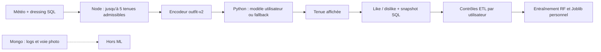
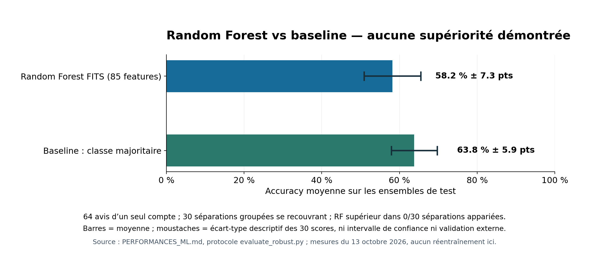

# FITS — Dossier de retour d'expérience E7B, option Big Data & IA

**Version de travail du 13 octobre 2026 — à relire et personnaliser par le candidat avant remise individuelle.** Les faits techniques et les chiffres ci-dessous sont traçables ; ils ne remplacent ni un cahier des charges client absent, ni une preuve de satisfaction utilisateur. Référence d'évaluation : grille RNCP40573 confirmée par le professeur, cellule C94 et compétences B94–B98 ; voir `AUDIT_FINAL_CRITERES.md` pour l'écart de numérotation BC04B/BC05 et le libellé incohérent B102. Ce REX suit les **neuf pièces demandées en C94**, en plus du programme d'analyse représenté par FITS et ses scripts.

## 1. Analyse de la problématique — C1, G01

**Décision recherchée.** FITS doit proposer à un utilisateur une tenue compatible avec la température et les vêtements de son dressing. Le problème d'IA est de choisir parmi plusieurs tenues admissibles celle qui a la meilleure chance de lui plaire, à partir de ses avis explicites. La fonctionnalité et la valeur prédictive sont deux questions distinctes : le service peut retourner un score et rester moins pertinent qu'une règle simple.

**Périmètre réellement observé.** Une application React Native récupère la météo, demande une génération, affiche la tenue et recueille like/dislike. L'API Node filtre les vêtements par température et zone, compose jusqu'à cinq candidats et transmet leurs features au service Python. Les avis alimentent un modèle distinct par utilisateur. Le prototype local ne traite **pas** un volume massif : au relevé du 13/10/2026, PostgreSQL contenait 271 tenues, 1 709 compositions et 69 avis ; la base Mongo distante contenait 233 logs et une photo. Six comptes SQL existaient, mais **un seul** avait des avis. Sources : `backend/controllers/tenueController.js`, `mobile/src/screens/home.js`, `ANALYSE_BIG_DATA.md`.

**Projet défini par le candidat.** Le candidat a confirmé le 13/10/2026 avoir lui-même défini FITS ; aucun cahier des charges externe ni retour explicite d'un commanditaire/utilisateur distinct des likes/dislikes du compte test n'est disponible. FITS doit donc être présenté comme un **prototype répondant à une hypothèse de besoin formulée pour le projet**, sans attribuer à un client réel des objectifs ou une satisfaction non constatés. La provenance et la représentativité des 69 avis demandent également confirmation avant l'oral.

Un protocole commun pour deux ou trois personnes distinctes est prêt dans `PROTOCOLE_TEST_UTILISATEUR.md`. À ce stade, il ne contient **aucun résultat** ; les observations ne devront être ajoutées qu'après les sessions, sur un environnement isolé ou sous forme d'observation sans écriture.

## 2. Gestion du projet et arbitrages — C94, G09–G10

Les étapes suivantes sont **des incréments techniques visibles dans le dépôt et l'historique Git**, pas des sprints contractuels reconstitués après coup :

| Incrément | Décision et preuve vérifiable | Critère de sortie démontré | Risque restant |
|---|---|---|---|
| Avis explicite et sécurité | Like/dislike mobile ; `evaluationController.js` refuse une tenue étrangère et valide les types ; tests `mobile/tests/home.test.js`, `backend/tests/evaluationController.test.js` | Le dislike est enregistré avant la régénération ; un utilisateur ne vote pas pour la tenue d'un autre | L'avis déclenche un réentraînement synchrone, dont la durée bout en bout n'est pas mesurée |
| Dataset personnel | `trainingDataset.js`, `outfitFeatures.js`, tests du dataset et de l'encodeur | Colonnes identiques en entraînement et prédiction, contrôles d'exclusion explicites | Historique sans snapshot susceptible de dériver |
| Modèles isolés | `ml-service/app.py`, tests Python ; stockage `user_<id>.joblib`, écriture temporaire puis remplacement | Deux utilisateurs peuvent avoir deux modèles ; absence de modèle → fallback explicite | Performance prédictive non garantie par un test fonctionnel |
| Validation hors ligne | `evaluate.py`, `evaluate_robust.py`, `audit_final_ml.py`, `PERFORMANCES_ML.md`, `ANALYSE_FINALE_ML.md` | Baseline, splits groupés, dispersion et limites documentées | Un seul compte, 29 vecteurs distincts, aucun jugement sur les candidats non retenus |
| Sécurité et observabilité de la soutenance | `SECURITE_UPLOADS.md`, `ANALYSE_POSTGRESQL.md`, `ANALYSE_MONGODB.md`, `PREUVES_JURY.md` | Risques de rôle/upload corrigés et limites résiduelles inventoriées | Protection des photos et suppression entre stockages incomplètes |

Le choix de **ne pas promouvoir** le modèle simple exploratoire et de **ne pas modifier** le RF/les Joblib après un résultat défavorable est un arbitrage de qualité : les mêmes 64 avis ne constituent pas un nouveau test indépendant. Les travaux d'indexation, de charge et de suppression inter-stockages sont reportés jusqu'à obtention de besoins, mesures et décisions de traitement. L'historique Git apporte la traçabilité des changements ; il ne prouve pas à lui seul gestion de budget, planning initial ou validation par commanditaire.

## 3. Stratégie coordonnée Big Data : sources, outils, étapes — C1/C5, G02–G04

| Dimension des 3V | Constat local mesuré | Stratégie proportionnée en cas de croissance |
|---|---|---|
| **Volume** | 69 avis, 271 tenues, base PostgreSQL 9,38 Mio ; 17 images disque suivies par Git occupent 20 120 Kio alloués | Suivre taille et rétention ; paginer les listes si nécessaire ; tester un index sur copie isolée seulement si les plans se dégradent |
| **Vélocité** | 69 avis répartis sur huit jours actifs ; au plus 27 un jour observé ; aucun débit temps réel établi | Mesurer latence complète et erreurs ; envisager un réentraînement asynchrone seulement si son coût bloque le parcours |
| **Variété** | Tables SQL, snapshot JSONB, documents Mongo, images, réponse météo JSON | Garder un contrat `outfit-v2` versionné, contrôler valeurs inconnues et snapshots ; ne pas faire entrer images et logs dans le RF sans besoin démontré |

PostgreSQL assure les relations métier et les avis ; MongoDB héberge logs d'authentification et une seconde voie photo, **hors pipeline ML** ; les images disque servent au mobile et ne sont pas des features. Python/FastAPI et scikit-learn servent au scoring personnel. Le trajet utile est :

Cette architecture n'établit pas une capacité Big Data horizontale. Ajouter Spark, Kafka ou Hadoop sans limite de volume/vélocité observée augmenterait le coût sans résoudre l'insuffisance d'avis. Source : `ANALYSE_BIG_DATA.md` et contrôleurs/services mentionnés dans le diagramme.

## 4. Rapport d'exploitation et qualité des données — C3, G04/G12

**Mesure agrégée en lecture seule** du 13/10/2026 sur PostgreSQL local `fits`, reproduite par `backend/scripts/reportEvaluationQuality.js` et consignée dans `QUALITE_DONNEES.md` :

| Étape / contrôle | Résultat et conséquence |
|---|---|
| Extraction | **69 avis** d'un seul utilisateur ayant voté : 44 likes, 25 dislikes |
| Rejet qualité | **5 avis** sans température, donc exclus par `trainingDataset.js` ; aucun avis sur tenue absente/étrangère observé |
| Chargement ML | **64 lignes** utilisables : 42 likes, 22 dislikes (65,6 % / 34,4 %) |
| Instantané historique | **3/69** snapshots valides, **66/69** absents ; l'état actuel des vêtements peut être utilisé pour l'historique |
| Représentation | **85 features**, dont 64 constantes sur cet échantillon ; 29 vecteurs distincts pour 64 avis |

Le pipeline **extrait** les évaluations du seul utilisateur authentifié, sa tenue et sa composition ; **contrôle** température entière/cohérente, booléen, propriété de la tenue, composition complète ; **transforme** snapshots ou vêtements courants en indicateurs numériques `outfit-v2` ; **charge** les lignes et le label dans `/train`. L'encodeur commun et `feature_version` protègent l'alignement entre entraînement et inférence (`trainingDataset.js`, `outfitFeatures.js`, `mlController.js`, `ml-service/app.py`). Les avis à température nulle sont exclus, sans valeur inventée. Pour les 66 avis sans snapshot, couleurs/favoris/catégories peuvent avoir changé après le vote : c'est un **risque de fuite temporelle non quantifié**, même si les tests groupés bloquent les duplications exactes entre train et test. Aucun backfill historique fiable n'est possible sans autre source.

L'export d'évaluation réel est privé et hors Git (`backend/scripts/exportEvaluationDataset.js`) ; la disponibilité d'un **jeu réel sur un serveur Git** demandée par la grille n'est donc pas démontrée. Les jeux synthétiques servent uniquement aux tests et à la démo, avec ce statut explicite. Une mise à disposition à un tiers nécessiterait une base légale, une minimisation et un format anonymisé/agrégé validé ; elle n'est pas documentée comme réalisée.

## 5. Modèles statistiques et apprentissage — C2, G05/G09/G10

Le service entraîne un `RandomForestClassifier(random_state=42)` par utilisateur si le dataset contient au moins **20 avis et cinq de chaque classe** (seuil initial configurable, non validé empiriquement). Jeux vides, classe unique et jeux trop petits gardent le modèle valide antérieur et retournent `insufficient_data`. En absence de modèle compatible, `/predict` renvoie un **fallback** fondé sur le ratio de vêtements favoris, avec `model_used` et `reason`. Le fallback est une règle d'application, **pas** une preuve de personnalisation. Code : `ml-service/app.py:82-163` ; tests : `ml-service/tests/test_app.py`.

L'évaluation hors ligne réelle locale utilise 64 avis d'un compte, **30 séparations groupées et recouvrantes** (`StratifiedGroupKFold`, mêmes méthodes pour tous les modèles). Une tenue ou un vecteur de features strictement identique ne traverse pas entraînement et test ; le label et l'identifiant de tenue sont exclus des features. Les trois modèles sont ajustés dans chaque partie d'entraînement seulement, sans toucher aux Joblib applicatifs. La régression logistique est **exploratoire**, jamais déployée.

| Modèle hors ligne | Accuracy moyenne ± écart-type | Précision like | Rappel like | F1 like | ROC AUC |
|---|---:|---:|---:|---:|---:|
| RF actuel, 85 features | **0,582 ± 0,073** | 0,619 | 0,901 | 0,728 | 0,402 |
| Majorité de l'entraînement | **0,638 ± 0,059** | 0,638 | 1,000 | 0,777 | 0,500 |
| Régression logistique L2 | **0,573 ± 0,105** | 0,613 | 0,825 | 0,692 | 0,436 |

Le RF ne bat la majorité en accuracy sur **aucune des 30 séparations appariées**. Ses 85 features n'apportent pas de gain démontré sur les 64 avis ; l'ablation en quatre plis de `ANALYSE_FINALE_ML.md` aboutit à la même réserve. Onze vecteurs de features identiques reçoivent les deux labels, ce qui limite la séparabilité observable. Les moyennes de splits qui se recouvrent **ne sont pas des intervalles de confiance indépendants**. La qualité du **classement des cinq candidats** n'est pas mesurable : FITS ne conserve ni les lots complets et scores, ni des avis sur les candidats non retenus ; AUC des avis retenus ≠ NDCG@5. **Conclusion :** l'intégration du modèle est démontrée, sa valeur prédictive et son gain métier ne le sont pas. L'application **utilise toujours le RF lorsqu'un modèle compatible existe** ; elle n'applique pas de garde-fou de promotion contre la baseline. Le fallback s'active quand aucun modèle compatible n'est disponible, pas quand le RF est faible. C'est une limite actuelle à reconnaître. Source chiffrée : `PERFORMANCES_ML.md` ; limites : `ANALYSE_FINALE_ML.md`.

## 6. Conception de la base de données — C4, G04

Le modèle PostgreSQL relie `utilisateur → tenue → composer → vetement` et `utilisateur + tenue → evaluation`. La clé composée `(id_utilisateur,id_tenue)` d'`evaluation` empêche deux avis du même utilisateur sur la même tenue ; `upsert` permet de modifier l'avis. `evaluation.feature_snapshot` est un JSONB nullable qui fige les attributs des nouveaux votes sans multiplier les tables historiques. Les clés étrangères et contraintes effectivement présentes ont été relevées par `backend/scripts/diagnosePostgres.js` dans une transaction **READ ONLY** ; le diagramme détaillé est dans `ANALYSE_POSTGRESQL.md`.

Sur cette petite base, cinq `EXPLAIN ANALYZE` de `SELECT` par lecture critique montrent une médiane côté serveur de **0,017 ms** pour les avis d'un utilisateur et **0,049 ms** pour les tenues d'un utilisateur. Des scans séquentiels sur 69 ou 271 lignes sont adaptés ici : ajouter un index sans mesure de gain alourdirait stockage et écritures. Ces temps **n'incluent pas** réseau, ORM ni API. Les contraintes SQL n'imposent pas l'unicité d'un dressing par utilisateur ni l'appartenance de chaque vêtement de `composer` au même propriétaire ; la vérification de propriété de la tenue évaluée est applicative. Trois nullabilités SQL diffèrent du modèle Sequelize, dont `evaluation.temperature`, d'où les cinq exclusions historiques. MongoDB ne participe pas à l'entraînement ; à 233 logs et une photo, son bénéfice face au coût de deux stockages n'est pas établi (`ANALYSE_MONGODB.md`).

## 7. Schématisation et conception du programme d'IA — C5, G02/G12

**Séquence fonctionnelle traçable.** `Home.handleGenerateTenue` transmet la température ; `tenueController.generateTenue` filtre le dressing et construit jusqu'à cinq candidats ; `outfitFeatures.extractFeatures` encode chaque candidat ; `mlClient.postToMl` transmet une identité issue du JWT avec le secret de service ; Python cherche `user_<id>.joblib`, vérifie la version et répond par score personnel ou fallback. Node choisit le meilleur score et écrit la tenue. `Home.handleEvaluation` attend l'écriture du like/dislike avant une régénération après rejet ; `evaluationController.create` contrôle la propriété, la température et la composition, puis capture un snapshot **avant** d'enregistrer l'avis et de déclencher le réentraînement. Si la capture échoue, le nouvel avis est refusé et l'écran permet de réessayer. Le contrôle des clics multiples est dans l'écran mobile.

**Preuve reproductible sans données réelles.** `backend/tests/mlJourney.integration.test.js` simule génération → dislike → snapshot → dataset → deux utilisateurs → prédiction/fallback avec modèles/données fictifs ; `ml-service/demo_isolated.py` montre `personalized` pour l'utilisateur entraîné et `fallback/no_model` pour un autre dans un répertoire temporaire. Les tests passent, mais cette démonstration **ne mesure pas l'utilité réelle**. Voir `DEMO_ML.md` pour la commande. Limite opérationnelle : jusqu'à cinq appels ML séquentiels, sans timeout Axios dans `backend/services/mlClient.js` ; disponibilité et temps complet du parcours non vérifiés.

## 8. Estimation des performances de l'application d'IA — C2/C5, G05/G07/G08

| Mesure datée du 13/10/2026 | Périmètre exact | Ce qu'elle ne prouve pas |
|---|---|---|
| **16,367 ms** médiane, trois essais | Construction des 64 lignes du dataset, catalogue + Node, hors démarrage et export JSON | Ni entraînement RF ni réponse HTTP |
| **5,859 ms** médiane, cinq essais | Fonction Python de prédiction personnalisée, avec chargement Joblib, hors HTTP | Ni classement des cinq tenues ni latence mobile |
| **0,017 / 0,049 ms** médianes | Deux lectures SQL côté serveur, cinq répétitions de chaque | Ni temps ORM, réseau, génération complète ni charge concurrente |
| **Non mesuré** | Génération et réentraînement de bout en bout | Aucun P95, SLA ou effet client ne peut être revendiqué |

Ces chiffres viennent de `ANALYSE_BIG_DATA.md` et `ANALYSE_POSTGRESQL.md`. Les avis « like/dislike » sont des labels d'entraînement du compte test, **pas** un retour client explicite sur l'application ; le candidat confirme qu'un tel retour n'a pas été collecté. En conséquence, ce REX **n'intègre pas de conclusion de satisfaction client**. KPI disponibles : taux d'exclusion **5/69**, répartition **42/22**, couverture snapshot **3/69**, accuracy et baseline ; KPI de valeur métier et service à définir puis mesurer, non à inventer.

## 9. Visualisations des données — G08/G11

Les deux images sont des **visualisations de mesures locales déjà rapportées**, pas une nouvelle interrogation de la base. Le premier graphique sépare explicitement trois dénominateurs : 69 avis bruts, 64 avis utilisables/labels, 69 avis bruts pour les snapshots. Le second met sur le même axe et le même protocole RF et baseline ; ses moustaches représentent l'**écart-type descriptif** sur 30 splits se recouvrant, pas une incertitude statistique indépendante. Données et méthode de lecture sont reprises dans `VISU_PREUVES.md`. Une équipe métier ou un commanditaire n'a pas validé ces choix de représentation.

## Protection des données, normes et limites de livraison — C3, G03/G06

| Support | Donnée potentiellement personnelle | Contrôle observé | Lacune avant toute promesse de conformité |
|---|---|---|---|
| PostgreSQL | Compte, garde-robe, avis, snapshots | JWT/contrôles de propriété, FK et cascades SQL ; export d'évaluation privé hors Git | Durée de conservation et mise à disposition à un tiers non arrêtées ; snapshots historiques très incomplets |
| MongoDB distant | Anciens logs d'authentification susceptibles de contenir e-mail/IP ; voie photo | Nouveaux logs sans ces champs ; nouvelles photos liées au propriétaire du JWT et lecture réservée à celui-ci ; diagnostic agrégé | Anciennes photos sans propriétaire refusées à la lecture, pas de TTL constaté, logs non supprimés explicitement à la suppression SQL ; statut de l'environnement distant à confirmer |
| Disque et dépôt Git | Images de vêtements ; Joblib personnels | Upload contrôlé en type/taille/nom, secret ML, stockage Joblib par utilisateur | `/uploads` reste public ; anciennes images suivies par Git ; suppression images/Joblib non orchestrée |
| Mobile | Jeton de session, affichage de la tenue | JWT envoyé à l'API, boutons d'avis verrouillés durant la requête | Aucune évaluation complète d'accessibilité ou de niveau de service produite |

Sources : `SECURITE_UPLOADS.md`, `ANALYSE_MONGODB.md`, `backend/controllers/utilisateurController.js:40-49`, `backend/app.js:45-48`. Les règles de rétention, droits d'accès, export, suppression et sauvegarde exigent une décision produit et une revue appropriée. **Ce dossier ne prétend pas que FITS est conforme au RGPD, aux exigences PSH ou à un SLA**. Corriger réellement la suppression inter-stockages est un travail ultérieur à cadrer et tester sur des données isolées, pas une opération à réaliser sur la base actuelle avant l'oral.

`CYCLE_VIE_DONNEES.md` détaille désormais chaque stockage, les liens d'appartenance connus et une proposition **non appliquée** de durée pour les journaux. Il ne remplace pas une purge ni un test de suppression de bout en bout.

## Vérification et usage du dossier

Les vérifications isolées du 13/10/2026 comptent **100 tests backend**, **26 tests Python** et **13 tests mobile** réussis ; Python n'a pas été relancé après le dernier correctif backend, qui ne change pas ses fichiers. Le test `backend/tests/fits.test.js` est exclu, car il écrit dans la base de développement. Les mesures réelles citées sont **celles des rapports existants**, sans nouvel entraînement ni mise à jour des données pour ce REX. Le code et les scripts sont suivis localement par Git ; l'accès du jury à un serveur Git et à un jeu de données publiable reste à confirmer.

**À confirmer personnellement avant remise :** formulation du besoin et rôle exact du candidat dans le projet ; éventuelles dates/jalons de gestion de projet ; provenance des avis du compte test ; modalités de remise et numéro de bloc auprès du responsable de session ; éventuel retour utilisateur futur authentique. Si ces informations restent indisponibles, conserver la formulation « non démontré » plutôt que de les compléter par hypothèse.
