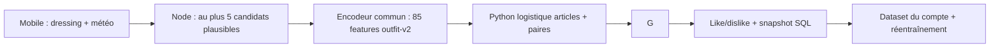

# FITS — État actuel du projet et preuves RNCP bloc 4

**Révision documentaire : 22 octobre 2026.** Cette fiche décrit le code présent sur `main` et le relevé de la base PostgreSQL locale `fits` effectué le **22/10/2026 à 11:47 UTC** en lecture seule. Les nouveaux avis et prédictions ont aussi été agrégés sans modifier de données ni de modèle. Les expériences ML portent sur des populations et protocoles précisés séparément. Les preuves détaillées sont [C1](preuves/C1_BESOIN.md), [C2](preuves/C2_MODELE.md), [C3](preuves/C3_DONNEES.md), [C4](preuves/C4_STOCKAGE.md) et [C5](preuves/C5_PROGRAMME.md). Le [guide de préparation](PREPARATION_SOUTENANCE.md) rassemble le protocole, les commandes et la trame orale.

La grille Excel **RNCP40573** fournie par le candidat a été validée par son professeur. Elle attend cinq décisions « valide / non valide », sans note officielle sur 20. Les libellés BC04B/BC04A du classeur et BC05 de la fiche publique divergent : vérifier le code à afficher auprès de l'établissement. Les fiches documentent des preuves, elles ne préjugent pas de la décision du jury.

## Synthèse des cinq axes

| Axe | Acquis vérifiable | Limite décisive |
|---|---|---|
| **C1 — besoin et 3V** | Besoin personnel formulé ; sources et indicateurs définis ; **754 tenues et 528 avis** relevés localement. | Aucun retour indépendant de volontaire ; temps de choix auto-estimé, non chronométré. |
| **C2 — modèle et mesure** | Articles/paires reste le modèle courant ; sur un ancien test commun, **42,9 % contre 28,6 %** pour le RF v2. Sur **95 votes prospectifs** à 13 °C, **49** prédits correctement contre **45** pour la baseline ; la nouvelle génération montre des manteaux auparavant exclus. | Avantage prospectif de quatre avis seulement ; le générateur et le modèle adaptatif ont évolué, et le classement de cinq candidats n'est pas mesuré. |
| **C3 — ETL et protection** | **462 snapshots valides sur 528 avis**, dont 346 v2 ; accès privés, suppression/reprise et tests isolés multi-stockages. | 66 snapshots historiques absents, sauvegardes réelles et rétention à opérer ; aucune conformité RGPD complète revendiquée. |
| **C4 — stockage** | Relations SQL et JSONB justifiés, relevé sur **754 tenues réelles** et benchmark d'index sur données fictives. | Charge réelle trop faible pour justifier un nouvel index ; latence globale et coût d'écriture non mesurés. |
| **C5 — programme IA** | Parcours mobile → Node → Python → vote testé ; modèles personnels, fallback, panne et isolation vérifiés. | Vérification finale sur l'iPhone et sur le réseau de l'oral encore nécessaire ; tests techniques ≠ performance métier. |

## Produit et architecture en place

Le mobile a été refondu : accueil et météo plus lisibles, états de chargement/erreur, dressing avec recherche, filtres, tri et favoris, formulaire d'ajout/modification avec palette contrôlée et **estimation thermique par catégorie ajustable**, profil avec édition et suppression confirmée. L'API reprend l'hôte LAN d'Expo ou `EXPO_PUBLIC_API_URL`. Le service reste local ; changer de réseau exige une vérification depuis l'appareil. [Écrans](../../mobile/src/screens/) ; [tests mobile](../../mobile/tests/).

Le générateur applique des règles de couches, température, couleurs simples et accessoires ; une chemise seule à 9 °C et des lunettes sans soleil étaient des problèmes signalés par le candidat. Le 22/10, une marge maximale de six degrés, plafonnée à 18 °C, a rendu les vestes et manteaux limités à 12 °C de nouveau éligibles à 13 °C, sans les rendre obligatoires ; une tenue avec couche extérieure n'affiche qu'un haut dessous. Les règles améliorent les **candidats**, sans être une preuve d'amélioration du ML. La génération demeure variée. Le vote porte sur la tenue entière ; un seul dislike ne révèle pas l'article responsable. La collecte attend l'enregistrement avant de proposer une autre tenue et empêche les doubles appuis.

Node tire l'identité du JWT et l'envoie au service Python avec un secret interne. Chaque compte dispose de son modèle. L'entraînement courant exige au minimum **20 avis avec snapshot v2 dont cinq par classe** ; en dessous, le modèle valide existant est conservé et l'absence de modèle donne un fallback explicite fondé sur le ratio de favoris. Ce seuil est opérationnel, **pas** un seuil de fiabilité prédictive. Les 85 features et les Joblib RF de référence n'ont pas été remplacés.

Depuis le basculement demandé le 21/10, `items-pairs-v1` est le **modèle normal de tous les comptes**. Le nom de fichier `experimental_app.py` et la variable `ML_EXPERIMENTAL_URL` sont historiques ; `ML_EXPERIMENTAL_USER_ID` est ignoré. Le service Python distinct et un dossier privé distinct conservent ses modèles. Sur ce Mac, le modèle du compte de test a été copié de `/private/tmp` vers le stockage privé persistant par défaut `~/.fits/models/items-pairs-v1`, sans écraser l'original ; les deux fichiers sont identiques. Il réutilise les 85 caractéristiques générales, puis ajoute les identités d'articles et paires de **snapshots v2** dans une régression logistique L2. L'application cliente ne choisit pas de modèle. Le RF ne classe plus les tenues ; son service est maintenu pour les anciens Joblib et leur suppression. Une panne ou un modèle manquant donnent le fallback explicite, sans substitution silencieuse du RF. [Démarrage et limites](../../ml-service/README.md#modele-articlespaires-par-defaut).

## C1 — Besoin et sources

Le candidat a conçu FITS pour gagner du temps le matin et explorer son dressing. Dans un auto-essai, il **estime** environ 5 min sans FITS et 30 s avec FITS pour trouver une tenue acceptable à la troisième suggestion ; trois des cinq premières lui plaisaient. Il n'a pas chronométré cette comparaison, n'a pas encore porté une tenue *après* l'avoir découverte dans FITS, et signale la saisie du dressing comme principale friction. Les photos de vêtements précédemment proposés sur Vinted lui ont fait envisager de nouvelles associations pendant ses essais. Ce récit ne remplace pas des retours de volontaires. [Protocole préparé](PREPARATION_SOUTENANCE.md#essais-de-volontaires).

**3V proportionnés :** le relevé local du 22/10 compte **6 utilisateurs, 68 vêtements, 754 tenues, 3 980 compositions et 528 avis** ; la saisie et les votes restent manuels, sans débit continu mesuré. La variété vient de SQL/JSONB, météo JSON, journaux Mongo et photos. Aucun volume massif Big Data n'est revendiqué. La stratégie consiste à mesurer usage, latence, erreurs et coût de saisie avant de complexifier l'infrastructure.

## C2 — Modèle et résultats à annoncer

L'encodeur `outfit-v2` comporte **85 colonnes** : quatre globales, neuf zones, 42 couleurs, dix catégories, 18 sous-catégories et deux associations générales. Sur les **64 avis historiques exploitables**, 64 colonnes étaient constantes et seulement **29 vecteurs distincts** existaient ; 11 vecteurs identiques portaient les deux labels. Ces constats concernent cette ancienne cohorte, pas nécessairement les nouveaux avis. Les 69 avis bruts initiaux incluaient cinq températures manquantes et 66 snapshots absents ; le candidat dit avoir voté parfois assez aléatoirement à cette époque.

Le compte récent compte maintenant **457 avis réels** (254 likes, 203 dislikes), tous avec snapshot ; **346 snapshots v2** enregistrent les identités nécessaires au modèle articles/paires. Ces 457 avis ne sont pas tous utilisables pour ce modèle : les snapshots antérieurs à v2 ne portent pas les mêmes identifiants figés. Le relevé agrégé actuel et les résultats d'évaluation ci-dessous répondent à deux questions différentes : quantité des avis disponibles et capacité prédictive mesurée sur un découpage donné.

**Résultat d'usage à montrer d'abord :** le 21/10, lors de la session à 15 °C associée par le candidat à la nouvelle variante, **64 tenues sur 97 lui ont plu, soit 66,0 %**, contre **25 sur 62 (40,3 %)** lors de la session à 11 °C. Ce sont des appréciations réelles de suggestions affichées. La variante exacte n'étant pas enregistrée par avis et les conditions ayant changé, l'écart de 25,7 points n'établit pas à lui seul un gain causé par le modèle. [Graphique des sessions](visuels/taux_likes_20261021.svg). Le **42,9 %** ci-dessous n'est **pas** un taux de tenues appréciées : il mesure la prédiction de votes sur un test hors ligne.

| Relevé réel | Méthode | Résultat et lecture |
|---|---|---|
| Compte récent, 21/10 : 62 avis à 11 °C puis 97 à 15 °C | **Taux de likes des tenues affichées**, sous les versions déclarées par le candidat ; comptages confirmés en SQL | **25/62 = 40,3 %** puis **64/97 = 66,0 %**. Écart **+25,7 points** ; météo et apprentissage évoluent, variante non mémorisée par avis : pas d'effet causal attribuable au modèle. |
| Compte récent, 251 snapshots v2 disponibles le 21/10 | **Même test** chronologique hors ligne pour tous les modèles, après purge : 182 train, 63 test, six exclus ; test à 15 °C avec 49 likes/14 dislikes | Accuracy majorité **22,2 %**, RF v2 **28,6 %**, RF+articles **41,3 %**, RF+articles+paires **42,9 %**, **modèle courant logistique articles/paires 42,9 %** ; AUC RF **0,386**, logistique **0,640**. L'écart logistique–RF est **+14,3 points** sur ce test précis. Ce découpage unique déjà exploré n'est pas une validation indépendante. |
| Compte récent, 22/10 : 95 votes appariés à une prédiction **avant le vote**, tous à 13 °C | Mesure prospective du système adaptatif ; baseline = classe majoritaire parmi les avis v2 antérieurs à chaque prédiction | **49/95 = 51,6 %** de prédictions correctes pour le modèle courant, **45/95 = 47,4 %** pour la baseline. Deux tenues supplémentaires affichées restent sans vote. Avant l'assouplissement thermique : **0/25** tenue avec couche extérieure et 10/25 likes ; après : **39/70** avec couche extérieure, dont huit manteaux épais auparavant limités à 12 °C, et 35/70 likes. Changement de générateur et réentraînement continu : pas d'effet causal attribuable au modèle. |
| Ancien compte, 64 avis utilisables | 30 séparations groupées recouvrantes | Accuracy RF **0,582 ± 0,073**, majorité **0,638 ± 0,059** ; RF meilleur 0/30. [Visuel daté](visuels/accuracy_rf_baseline.png). |
| Compte récent, relevé initial de 100 avis à 19 °C | Même famille de séparations groupées | RF **0,624 ± 0,090**, majorité **0,659 ± 0,065** ; RF meilleur 4/30. |

Les modèles hors ligne sont ajustés sur le train seulement ; le vocabulaire articles/paires y est appris. La purge sépare tenues, compositions et vecteurs identiques, mais le partage d'articles laisse des dépendances. Les splits recouvrants produisent des **écarts-types descriptifs**, pas des intervalles de confiance. Seule la tenue affichée est évaluée : AUC sur ces avis n'est pas une mesure du classement des cinq candidats, et NDCG@5 n'est pas calculable honnêtement. **Conclusion C2 : le modèle articles/paires fonctionne et fait mieux que le RF sur le test hors ligne commun ; sur les 95 avis prospectifs, son avantage sur la baseline n'est que de quatre prédictions.** Les 66 % de tenues appréciées concernent une autre session, le 21/10. La généralisation et la qualité du classement restent à mesurer. Le candidat choisit de **conserver le modèle actuel** pour l'oral. [Méthode et données séparées](preuves/C2_MODELE.md).

## C3 — ETL et cycle de vie

Le backend vérifie propriété de la tenue, booléen, température, composition et snapshot. Il fige les attributs et identifiants des nouveaux avis ; l'ETL prépare le dataset du seul utilisateur, normalise `outfit-v2` et transmet les labels à Python. **Dernier relevé complet du 22/10 : 528 avis, 299 likes, 229 dislikes, cinq températures absentes, 66 snapshots absents, 462 snapshots valides dont 346 v2 ; aucune tenue absente ou étrangère ni divergence de température.** Les cinq températures manquantes sont exclues sans imputation ; les anciens avis sans snapshot peuvent refléter l'état **actuel** des vêtements. Aucune donnée historique n'a été modifiée pour établir ces preuves. [Script agrégé en lecture seule](../../backend/scripts/reportEvaluationQuality.js).

Inscription limitée au rôle `user`, uploads et images authentifiés, vérification du propriétaire et modèles séparés. Le mobile ne demande plus de téléphone ni de code postal pour les nouveaux essais ; seules les données nécessaires à la connexion et la ville utilisée pour la météo restent dans ce formulaire. Le profil permet de supprimer son compte : SQL, MongoDB, images attribuables et Joblib personnels sont coordonnés ; `202` signifie qu'une reprise est nécessaire. Les nouveaux reçus de suppression ne conservent plus les noms d'images ; les anciens restent lisibles pour les restaurations. Les tests utilisent PostgreSQL/Mongo/FastAPI et répertoires **temporaires**, y compris panne et restauration SQL. Le périmètre retenu avant la soutenance est une démonstration locale, mais **MongoDB configuré reste distant**. Sur les données réelles, l'ancien vêtement sans propriétaire, les images suivies dans Git, les anciennes valeurs de téléphone/code postal et la sauvegarde avant migration restent des limites à suivre. Le réglage initial de 30 jours pour les journaux Mongo, qui comprennent aussi des événements de connexion, et la revue des sauvegardes ne sont pas une politique de rétention complètement opérée. Aucune conformité RGPD complète n'est revendiquée. [Détails C3](preuves/C3_DONNEES.md).

## C4 — Stockage et performance

PostgreSQL relie utilisateur, dressing, vêtement, tenue, composition et évaluation ; `feature_snapshot` est un JSONB versionné. La clé composée des évaluations sert déjà à lire les avis d'un compte. MongoDB héberge des logs et une voie photo, sans alimenter le ML. La complexité de deux stockages est reconnue. La migration additive de propriété des vêtements a été testée sur fixture isolée, puis **appliquée le 22/10 à la base locale `fits` après sauvegarde privée** : 67 vêtements attribués sur 68, un cas historique indéterminé conservé pour revue. De nouveaux avis et tenues ont été créés ensuite ; le parcours complet de suppression d'un compte réel n'a pas été rejoué, mais la génération, le vote et les snapshots sont attestés par le relevé prospectif.

**Relevé SQL du 22/10 à 11:47 UTC :** six utilisateurs, 68 vêtements, 754 tenues, 3 980 compositions et 528 avis ; base `fits` d'environ **10,7 Mo**. Les médianes serveur du **21/10** sur cinq `SELECT` par compte en transaction `READ ONLY` étaient **0,076 ms pour les tenues** et **0,074 ms pour les avis** ; elles excluent HTTP, ORM, réseau et concurrence. Le benchmark distinct sur un PostgreSQL isolé avec **100 000 tenues fictives** a mesuré la même requête à **2,081 ms sans index** puis **0,139 ms avec index B-tree**, au coût de **728 Kio** de stockage. [Données/plans fictifs](benchmark_stockage_synthetique.json) ; [visuel synthétique](visuels/stockage_synthetique.svg). Aucune donnée réelle n'a servi à ce benchmark. Il ne justifie pas encore cet index dans la petite base réelle.

## C5 — Programme et validation technique

Le parcours génération → classement personnel/fallback → avis → snapshot → dataset → réentraînement est couvert par des tests Node, Python et mobile. Le lanceur d'intégration démarre de **vrais PostgreSQL, MongoDB et FastAPI temporaires**, sans viser les données applicatives. Les tests vérifient 85 colonnes cohérentes, deux utilisateurs isolés, avis persistant, panne/fallback et absence de remplacement d'un modèle valide après échec. L'intégration du modèle courant relie Node au vrai Python articles/paires avec données fictives. [Scénario](preuves/C5_PROGRAMME.md).

Vérification du **22/10** sur le code actuel : **191 tests backend (26 suites)**, avec pont Node → Python, **51 tests Python** et **64 tests mobile (neuf suites)** réussis. Les **huit scénarios d'intégration isolés** avec PostgreSQL, MongoDB et FastAPI temporaires avaient aussi réussi le 22/10 avant le dernier réglage thermique ; ils n'ont pas été relancés depuis. Le lint mobile, les exports Expo web/iOS et un parcours visuel web fictif avaient réussi auparavant, sans nouvelle modification mobile. Ces tests n'établissent ni SLA, ni qualité prédictive, ni rendu iPhone complet. **La répétition finale sur appareil réel et sur le réseau de l'oral reste à confirmer.**

## Décisions avant l'oral

1. **Conserver le modèle actuel pour l'oral.** Présenter articles/paires comme modèle courant pour tous les comptes et le RF comme comparateur historique ; ne pas présenter le taux de likes comme accuracy. La règle de génération du 22/10 est distincte d'un changement de modèle.
2. **Réaliser si possible 2–3 essais utilisateurs honnêtes**, avec protocole déjà préparé, ou annoncer leur absence. Ne pas mélanger leurs avis avec les anciens comptes.
3. **Répéter une fois le parcours sur le réseau et l'iPhone de l'oral** : connexion, images privées, dressing, génération, vote, score articles/paires ou fallback, suppression sur compte fictif uniquement si prévue. Préparer la démo synthétique isolée comme secours.
4. **Conserver les limites explicites** : classement des candidats non jugés non mesuré, petit jeu dépendant de la météo, sauvegardes/ancien historique à traiter, benchmark C4 fictif. Aucune migration, purge ou promotion automatique n'est nécessaire avant la soutenance.
