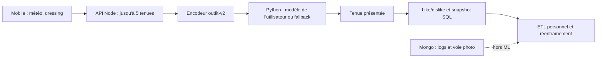
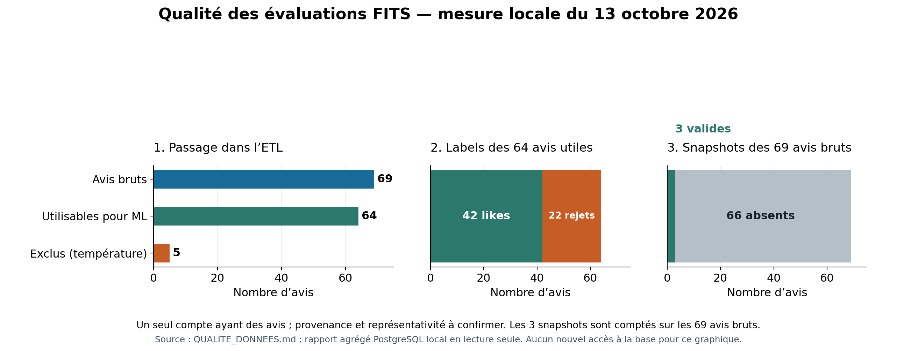
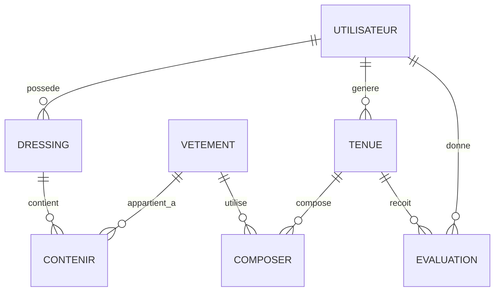
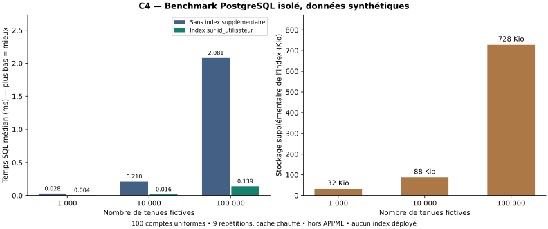

# FITS — État actuel et preuves RNCP Big Data & IA

**État technique actualisé le 20 octobre 2026 pour la suppression depuis le profil mobile.** Les tableaux historiques restent datés de leur collecte ; aucun modèle applicatif n'a été remplacé. Ce document consolide les faits. Les fiches [C1](preuves/C1_BESOIN.md), [C2](preuves/C2_MODELE.md), [C3](preuves/C3_DONNEES.md), [C4](preuves/C4_STOCKAGE.md) et [C5](preuves/C5_PROGRAMME.md) relient chaque axe à ses preuves et à ses lacunes. Le [guide de préparation](PREPARATION_SOUTENANCE.md) contient les commandes, le protocole utilisateur et les huit diapositives. Les anciens documents retirés restent consultables dans l'historique Git.

Les sections ci-dessous conservent l'ancien compte comme cohorte historique et présentent séparément les relevés successifs du compte récent. Le candidat a confirmé que les **82 nouveaux votes à 18 °C** reflètent ses goûts, météo comprise. Les exports privés temporaires ont été supprimés après analyse ; seuls les agrégats sont publiés. PostgreSQL local ne répondait pas lors du présent tri documentaire : aucun effectif n'a été remesuré.

La grille Excel RNCP40573 fournie par le candidat est celle validée par son professeur. Elle demande cinq décisions **VALIDE / NON VALIDE**, sans barème officiel sur 20. Son libellé BC04B, sa mention BC04A en B102 et la fiche publique BC05 divergent : confirmer le code à afficher auprès du responsable de session. Le projet a été défini par le candidat ; aucun commanditaire ni retour utilisateur explicite n'a encore été recueilli.

## Lecture des cinq compétences après renforcement

Les libellés de référence sont ceux des cellules **B94–B98**, le dossier attendu est en **C94** et les critères communs en **D94** de la grille validée. Les axes ci-dessous sont une correspondance de preuves, **pas une décision du jury**.

| Axe | Preuve consolidée maintenant | Ce qui reste nécessaire |
|---|---|---|
| C1 — analyser la problématique et les 3V | Besoin personnel expliqué par le candidat ; objectifs temps/découverte/réutilisation ; sources, mesures locales et protocole fixé avant essai | Essais des volontaires et résultats d'utilité, encore absents ; aucun volume Big Data réel revendiqué |
| C2 — concevoir et évaluer les modèles | RF de référence, baseline, regroupement anti-doublons, variabilité, limites et décision de ne pas promouvoir un modèle | Les 82 avis v2 suggèrent un signal sur un seul contexte à 18 °C, sans gain généralisable démontré ; classement des lots non mesurable |
| C3 — ETL, qualité, interprétation et protection | Snapshot/ETL testés avec PostgreSQL réel temporaire ; images privées, révocation de session ; suppression SQL/Mongo/disque/Joblib, reprise et rétention éprouvées | Traitement autorisé des anciens éléments non attribuables ; application opérationnelle de la rétention/sauvegarde et essai sur appareil |
| C4 — conception de la base | Schéma/FK vérifiés, rollback et restauration testés ; benchmark d'index avant/après sur 1 000 à 100 000 lignes fictives avec coût de stockage | Charge représentative et coût des écritures avant toute migration ; aucune modification du schéma réel |
| C5 — programme IA | Parcours HTTP Node/FastAPI avec vrais stockages temporaires ; 85 colonnes alignées, deux comptes, timeout, fallback cohérent et test de panne | Répétition mobile sur le réseau de soutenance ; disponibilité réelle et PSH à vérifier en usage |

**Décision :** les preuves techniques sont renforcées ; déclarer les cinq axes « validés » serait prématuré. La grille demande notamment des retours clients argumentés : le besoin exprimé par le concepteur ne constitue pas un retour de test externe. Les fixtures fictives et les scripts sont publiables avec le code ; les préférences individuelles réelles restent privées. La remise effective sur le serveur Git du jury doit être vérifiée par le candidat.

## Parcours et architecture réellement implémentés

Le mobile attend l'enregistrement du dislike avant de régénérer et bloque les clics multiples. Le backend vérifie la propriété de la tenue et capture les caractéristiques au moment des nouveaux avis. Avant le score ML, `backend/services/outfitCandidate.js` limite les couches par temps doux, écarte les manteaux lourds au-dessus de 12 °C, supprime la couche extérieure à partir de 20 °C et privilégie au plus deux couleurs vives distinctes lorsque le dressing permet un choix. Après le retour du candidat du 14/10/2026, il prend une couche extérieure disponible à 12 °C ou moins, permet un t-shirt sous une chemise par temps froid et ne sélectionne des lunettes de soleil que si l'icône météo transmise indique un ciel dégagé ou peu nuageux de jour (`01d`/`02d`). Casquette, lunettes et écharpe peuvent coexister car leurs zones sont distinctes ; chaque zone accessoire reste facultative. Ce sont des **heuristiques initiales de composition**, non des préférences apprises ou des seuils validés empiriquement. L'identité du modèle vient du JWT côté Node ; Python exige le secret interne commun, valide la version et les colonnes, puis conserve un Joblib par utilisateur. L'entraînement requiert par défaut **20 avis, dont cinq de chaque classe** : ce seuil évite les jeux manifestement insuffisants, sans garantir un modèle utile. Sans modèle compatible, la prédiction renvoie explicitement `fallback` avec le ratio de favoris ; un échec d'entraînement ne remplace pas le modèle valide. Tests isolés : `backend/tests/outfitCandidate.test.js`, `mlJourney.integration.test.js`, `ml-service/tests/test_app.py` et `ml-service/demo_isolated.py`. La démo synthétique prouve le fonctionnement, pas la qualité prédictive.

## C1 — Besoin, sources et 3V

**Besoin confirmé par le candidat :** gagner du temps le matin avec une proposition à partir du dressing, découvrir des associations auxquelles il n'aurait pas pensé et remettre en valeur des vêtements oubliés. La température et les préférences sont des moyens pour rendre la proposition utilisable. C'est un projet personnel ; aucun gain effectif n'a encore été mesuré.

**Retour qualitatif du candidat, 14/10/2026 :** à 9 °C, une proposition chemise–jean–chaussures paraît insuffisamment chaude ; des lunettes de soleil sortaient sans rapport avec l'ensoleillement. Le correctif thermique et le filtre de lunettes sont testés sur des fixtures. Le candidat souhaite surtout apprendre ses préférences pour des **paires de vêtements identifiés** : apprécier un jean dans plusieurs tenues et rejeter la combinaison de ce même jean avec un manteau donné. La composition SQL conserve les identifiants tant que les tenues existent ; les nouveaux snapshots version 2 les figent aussi. `outfit-v2` ne les transmet toujours pas au RF actuel. Un vote sur la tenue entière ne désigne pas à lui seul la paire responsable. Un dislike devrait réduire une préférence estimée, jamais interdire la paire : les goûts peuvent changer. Un [essai comparatif hors ligne](preuves/C2_MODELE.md) est prêt, sans modèle personnel remplacé ni performance réelle nouvelle. Ce retour personnel sert à formuler des hypothèses, **pas** de résultat d'essai externe ni de métrique de performance du RF.

**Entretien et auto-essai du concepteur, 14/10/2026 :** il utilise encore FITS pour tester, sans avoir porté une tenue *à la suite* de sa suggestion. Il était chez lui et ne comptait pas sortir, mais aurait porté la première tenue aimée s'il était sorti. Il estime avoir mis environ cinq minutes à choisir sans FITS et trente secondes avec FITS jusqu'à une première tenue acceptable, obtenue à la troisième suggestion. Il dit avoir aimé trois des cinq premières et avoir continué volontairement à générer pour tester la variété des propositions, sans difficulté de choix signalée. Les durées sont estimées, sur un seul essai personnel dans un ordre fixe : le gain de temps effectif n'est pas établi. En important dans FITS des photos de vêtements proposés sur Vinted, il a découvert des associations possibles avec son dressing actuel, sans avoir encore porté ces tenues. La saisie manuelle du dressing est le principal coût d'entrée déclaré, non chronométré. [Compte rendu détaillé et limites](preuves/C1_BESOIN.md#entretien-et-auto-essai-du-concepteur--14102026).

Trois indicateurs métier seront relevés séparément : **temps pour choisir une tenue acceptable**, **nombre de propositions jugées intéressantes et nouvelles / propositions examinées**, **nombre de tenues acceptées contenant un vêtement déclaré oublié**. Le dernier indicateur exige une déclaration avant l'essai ; il ne peut pas être déduit de la base, qui ne connaît pas les vêtements effectivement portés. Une tenue peut surprendre tout en étant rejetée : like, nouveauté et gain de temps ne sont pas interchangeables. Le protocole comparatif et les cases à remplir figurent dans le guide, sans résultat inventé.

**Critères vérifiables sans utilisateur externe :** une tenue générée contient au moins un haut, un bas et des chaussures quand le dressing le permet ; à partir de 20 °C, elle n'ajoute pas de couche extérieure ; like et dislike sont enregistrés sur la tenue du compte authentifié ; un compte sans modèle utilise un fallback explicite. Les tests isolés couvrent ces règles fonctionnelles. Ils valident l'exécution du besoin supposé, **pas** son utilité ressentie : l'essai des volontaires reste la preuve C1 manquante.

| Mesure locale du 13/10/2026 | Valeur | Portée |
|---|---:|---|
| PostgreSQL `fits` sur le Mac : utilisateurs / vêtements / tenues / compositions / avis | 6 / 22 / 271 / 1 709 / 69 | Base entière : 9,38 Mio ; 10 tables métier : 624 Kio |
| MongoDB distant `fits` : logs / photos | 233 / 1 | Statut de l'environnement distant non confirmé ; hors ML |
| Images dans `backend/uploads` suivies par Git | 17 au relevé historique | 52 chemins suivis constatés dans l'index Git lors du tri du 14/10 ; aucun retrait d'image effectué |
| Préparation de 64 lignes ML, 3 lectures | médiane 16,367 ms | Catalogue et Node ; hors entraînement, HTTP et export |
| Prédiction Python personnalisée, 5 lectures | médiane 5,859 ms | Fonction avec chargement Joblib ; hors HTTP et génération |

**Volume :** quelques centaines de lignes métier et des images plus lourdes que les tables ; aucun volume massif. **Vélocité :** 69 avis répartis sur huit jours actifs, jusqu'à 27 sur un jour observé ; aucun débit continu mesuré. **Variété :** relations SQL, snapshot JSONB, documents Mongo, images et météo JSON, dont seuls les avis/attributs vestimentaires alimentent le RF. Si l'usage croît, mesurer d'abord tailles, latence complète et erreurs ; paginer, indexer ou découpler l'entraînement seulement lorsqu'une mesure le justifie. Kafka/Spark/Hadoop n'ont pas de justification observée. Reproduction agrégée, sans écriture : `backend/scripts/diagnosePostgres.js` et `backend/scripts/diagnoseMongo.js` (ce dernier interroge la base Mongo distante).

## C2 — Modèle, données et performance mesurée

L'encodeur `outfit-v2` produit **85 caractéristiques** : 4 globales, 9 zones, 42 couleurs, 10 catégories, 18 sous-catégories et 2 associations. Les deux associations actuelles indiquent seulement « même couleur » et « neutre avec couleur » pour haut/bas ; elles ne codent **pas** une paire précise comme marron/noir ou rouge/jaune. Le nouveau sélecteur mobile impose une **couleur principale** parmi 12 valeurs ; l'API la canonise, tandis que l'encodeur continue de lire les anciennes couleurs libres. Ni l'ordre ni la version des 85 colonnes n'ont changé. Sur les 64 avis historiques exploitables, **64 colonnes sont constantes** ; les 21 autres ne constituent que 17 profils de colonnes distincts, avec des redondances. Une feature variable n'est pas pour autant prédictive. Parmi les 64 tenues évaluées, il n'y a que **29 vecteurs de features distincts** ; 11 vecteurs identiques portent les deux labels. La représentation ne sépare donc pas tous les avis observés.

Le **relevé initial de 69 avis bruts** provient d'un seul compte : 44 likes et 25 dislikes. Cinq températures manquantes sont exclues ; **64 lignes ML** restent dans ce relevé, avec **42 likes et 22 dislikes**. Seuls **3/69 avis** ont un snapshot valide ; les 66 autres peuvent être reconstruits avec l'état *actuel* des vêtements. **Le candidat précise désormais avoir attribué une partie des anciens likes/dislikes de façon assez aléatoire.** La proportion exacte n'est pas connue : ces chiffres vérifient le pipeline sur les avis historiques mais ne permettent pas de juger fidèlement l'apprentissage de ses préférences. Aucun avis synthétique n'entre dans les mesures ci-dessous.

`ml-service/evaluate_robust.py` a produit **30 séparations groupées admissibles** avec `StratifiedGroupKFold` à quatre plis et des graines à partir de 42. Une même tenue ou un vecteur identique ne traverse pas entraînement et test. Les modèles sont ajustés uniquement sur la partie entraînement : RF identique à `/train` (`random_state=42`), `DummyClassifier` majoritaire, régression logistique L2 standardisée. Le like est positif. Les splits **se recouvrent** : les écarts-types ci-dessous décrivent leur variabilité, pas des intervalles de confiance indépendants.

| Modèle hors ligne | Accuracy | Balanced accuracy | Précision like | Rappel like | F1 like | ROC AUC | Average precision |
|---|---:|---:|---:|---:|---:|---:|---:|
| RF, 85 features | **0,582 ± 0,073** | 0,467 ± 0,045 | 0,619 ± 0,059 | 0,901 ± 0,135 | 0,728 ± 0,066 | 0,402 ± 0,088 | 0,604 ± 0,074 |
| Majorité de l'entraînement | **0,638 ± 0,059** | 0,500 ± 0,000 | 0,638 ± 0,059 | 1,000 ± 0,000 | 0,777 ± 0,045 | 0,500 ± 0,000 | 0,638 ± 0,059 |
| Régression logistique exploratoire | 0,573 ± 0,105 | 0,468 ± 0,053 | 0,613 ± 0,085 | 0,825 ± 0,232 | 0,692 ± 0,136 | 0,436 ± 0,081 | 0,623 ± 0,071 |

Le RF n'a dépassé la majorité en accuracy sur **aucun des 30 splits appariés**. Une expérience distincte, sur les **mêmes 64 avis** et quatre plis groupés fixés, a comparé RF85, RF avec quatre variables globales et baseline : accuracy moyenne **0,517 / 0,609 / 0,670** ; ROC AUC pondérée par paires **0,358 / 0,485 / 0,500**. Cette ablation suggère que les indicateurs supplémentaires n'aident pas *sur cet échantillon* ; elle ne valide aucune autre variante ni un changement de production. Les plis inégaux, les vêtements partagés entre tenues, les votes parfois aléatoires et surtout les 66 snapshots manquants limitent fortement l'interprétation. Le groupe par tenue/vecteur élimine les doublons exacts entre train et test, **pas toutes les fuites possibles**.

Le backend ne conserve ni le lot complet des cinq candidats et leurs scores, ni des jugements sur les candidats non retenus. ROC AUC/AP sur les avis exposés ne mesurent donc pas le classement d'un lot : **NDCG@5 et gain métier non mesurables honnêtement**. Le RF reste une référence expérimentale utilisée lorsqu'un modèle compatible existe ; il n'y a pas de garde-fou le comparant à la baseline en production. Aucune modification du RF ou des Joblib n'est justifiée avant l'oral.

### Cohorte récente distincte — compte SQL 6

Relevé local du 13/10/2026 : **100 avis, 67 likes et 33 dislikes**, tous avec température et snapshot valide ; 100 tenues distinctes. Les 100 températures valent **19 °C** et les indicateurs de favoris sont nuls sur toutes les lignes. Parmi les 85 features, 59 sont constantes ; 80 groupes de vecteurs indépendants restent après regroupement, 20 lignes répètent un vecteur et huit vecteurs identiques portent des avis contradictoires. Ces observations limitent la généralisation à d'autres températures ou dressings.

`evaluate_robust.py` a produit **30/30 séparations groupées admissibles**, avec la même méthode et les mêmes graines pour les trois modèles. Les groupes relient une tenue et les vecteurs de features identiques ; les ensembles d'entraînement et de test ne partagent donc aucun de ces doublons exacts. Les scores suivants proviennent uniquement des parties test ; le RF est réentraîné hors ligne à chaque séparation avec les paramètres actuels, sans charger ou remplacer le Joblib de l'application.

| Modèle hors ligne, compte 6 | Accuracy moyenne ± écart-type | Balanced accuracy | F1 like | ROC AUC |
|---|---:|---:|---:|---:|
| RF, 85 features | **0,624 ± 0,090** | 0,529 | 0,744 | 0,566 |
| Majorité de l'entraînement | **0,659 ± 0,065** | 0,500 | 0,793 | 0,500 |
| Régression logistique L2 exploratoire | **0,655 ± 0,096** | 0,595 | 0,747 | 0,611 |

Le RF dépasse la majorité en accuracy sur **4/30 séparations**. Une séparation stratifiée 75/25 non groupée par vecteur donne RF **0,640** contre majorité **0,680** sur 25 avis de test ; elle est moins stricte contre les vecteurs répétés et n'est pas le résultat principal. Les 30 séparations se recouvrent : l'écart-type n'est pas un intervalle de confiance indépendant. L'AUC porte sur les seuls avis affichés, pas sur le classement des cinq candidats. Ce compte récent améliore la qualité des snapshots, **pas encore la preuve de supériorité du RF**. Il ne faut ni fusionner ses avis avec ceux du compte historique ni utiliser les scores exploratoires pour promouvoir un nouveau modèle.

**Essais d'interactions, sans changement du modèle applicatif :** sur l'ancien relevé à 111 avis, un unique test temporel de 28 avis donnait 0,643 d'accuracy au RF v2, 0,750 au RF enrichi en articles+paires et 0,607 à la majorité. Les identifiants étaient reconstruits depuis `composer` et l'ablation articles seuls a été ajoutée après un résultat favorable : ce signal reste exploratoire. Un relevé ultérieur de **82 nouveaux votes v2 sincères**, 41 likes/41 dislikes, tous à **18 °C**, a été évalué séparément. Sur 30 séparations groupées recouvrantes, accuracy RF **0,502 ± 0,066**, majorité **0,429 ± 0,049**, logistique **0,627 ± 0,114**. Sur un seul test chronologique de 21 avis, RF v2 **14/21**, RF+articles+paires **13/21**, majorité **10/21** et logistique+articles+paires **16/21**. Les résultats varient selon la cohorte et la méthode ; la généralisation et la qualité du classement des cinq candidats restent inconnues. [Méthode et limites dans C2](preuves/C2_MODELE.md). Aucun Joblib ni endpoint Python n'a été modifié.

## C3 — ETL, qualité et protection des données

**Extraction :** avis et compositions du seul utilisateur concerné. **Contrôles :** propriétaire de la tenue, température entière/cohérente, booléen, composition complète, snapshot versionné. **Transformation :** snapshot figé si présent, sinon attributs courants ; normalisation en colonnes `outfit-v2`. **Chargement :** envoi des lignes numériques et labels à `/train` avec l'identité authentifiée. Les cinq avis sans température sont exclus sans imputation ; aucun ancien snapshot n'a été inventé. Les nouveaux votes dont le snapshot échoue sont refusés sans enregistrer l'avis. Depuis ce changement, le snapshot version 2 inclut l'identifiant du vêtement ; la version 1 reste acceptée. L'export privé `--interactions` ajoute ces identifiants (ou leur reconstruction depuis `composer`, explicitement signalée) **hors** dataset de production. Scripts de preuve : `backend/scripts/reportEvaluationQuality.js` (agrégats en lecture seule) et `backend/scripts/exportEvaluationDataset.js` (export privé hors Git, garde-fous sur la base locale).

**Relevés de qualité distincts :** l'ancien compte comptait 69 avis, dont cinq sans température et 66 sans snapshot ; 64 lignes étaient exploitables. Le relevé agrégé du 14/10 avant les nouveaux votes v2 comptait 182 avis sur deux comptes, 116 snapshots valides et 66 absents. Un relevé ultérieur en lecture seule a constaté **264 avis** sur deux comptes, dont **82 nouveaux snapshots v2 valides** (41 likes/41 dislikes, 18 °C). Ces effectifs n'ont pas été remesurés lors du présent tri car PostgreSQL local est arrêté. Les cohortes ne sont jamais fusionnées pour entraîner un modèle commun ; les anciens snapshots manquants n'ont pas été reconstruits artificiellement. Le graphique ci-dessus décrit uniquement les 69 avis historiques.

L'inscription publique impose le rôle `user`. Les uploads sont authentifiés, limités à 5 Mio, à JPEG/PNG/WebP et à une signature initiale cohérente ; leurs nouveaux noms associent l'identifiant du compte à un UUID, et `backend/uploads/` est désormais ignoré pour les nouveaux fichiers Git (les fichiers déjà suivis restent suivis). Les nouvelles couleurs sont choisies dans une palette contrôlée, sans migration ni changement des anciennes valeurs. Les nouveaux logs d'authentification n'ajoutent plus e-mail/IP ; la voie photo Mongo vérifie le propriétaire à la lecture.

**Suppression coordonnée, éprouvée avec des comptes fictifs :** `accountDeletion.js` enregistre un manifeste privé, supprime l'utilisateur SQL et ses vêtements exclusivement associés dans une transaction, puis efface les photos/logs Mongo liés à son identifiant, son Joblib et les images disque attribuables non partagées. `200` indique la fin de ce nettoyage identifiable ; `202` conserve la tâche à reprendre. Les essais de `tests/isolated/pipeline.test.js` utilisent **PostgreSQL, MongoDB, Express et FastAPI réels**, avec données et fichiers temporaires : panne Mongo injectée puis reprise, isolation de l'autre compte et rollback SQL vérifiés. Aucun compte réel n'a été supprimé.

Depuis le 20/10/2026, le profil mobile propose « Supprimer mon compte » avec confirmation, blocage des appuis répétés et retour à la connexion après réponse `200` ou `202`. Les tests mobiles utilisent des mocks ; le parcours sur appareil et l'effacement d'un compte fictif dans l'application restent à vérifier manuellement. La suppression efface les lignes actives du compte, elle ne les masque pas. Elle ne garantit pas l'effacement immédiat de toutes les copies : nettoyage `202` à reprendre, anciens fichiers sans propriétaire fiable, sauvegardes et reçus techniques privés restent des limites.

**Accès et restauration :** `/uploads/:filename` demande désormais une session active et la propriété du fichier. Les nouveaux noms indiquent le compte ; les anciens UUID sont autorisés seulement via une relation SQL avec son dressing ou sa tenue. Les liens symboliques sont refusés ; la réponse interdit le cache partagé. Le mobile transmet le JWT uniquement aux images de l'origine de l'API ; sur le web, il utilise un téléchargement authentifié et une URL blob libérée au démontage. Les mises à jour de vêtements ne peuvent plus modifier leur clé primaire ni s'attribuer la nouvelle image d'un autre compte.

Le middleware de session relit l'existence et le rôle SQL : un ancien JWT ne réactive pas un compte effacé ou un rôle retiré. Un reçu minimal (identifiant, noms techniques de fichiers, date) subsiste dans `deletion-jobs/receipts` pour détecter une restauration ayant réintroduit ce compte ; le middleware le refuse aussi. Le service Python conserve un marqueur `user_<id>.deleted` qui bloque un entraînement tardif. **Le registre courant et ces marqueurs doivent survivre à la restauration**, et les identifiants effacés ne doivent pas être réutilisés. Un test `pg_dump`/`pg_restore` sur la base fictive confirme le blocage du compte restauré ; il ne constitue pas une restauration complète de Mongo/images/Joblib.

Si une réponse `202` apparaît lors d'un futur essai autorisé, vérifier d'abord la base, les deux services et les manifestes dans `backend/private/deletion-jobs`, puis exécuter **depuis `backend`** `node scripts/retryAccountDeletionCleanup.js` pour reprendre les tâches idempotentes. Cette commande peut effacer des ressources réelles en attente : elle n'est pas une simple vérification et n'a pas été exécutée ici. Le répertoire privé doit être conservé avec le déploiement jusqu'à la fin de chaque nettoyage.

**Rétention retenue pour le prototype local :** compte/dressing/avis/snapshots tant que le compte est utilisé, puis suppression à sa demande ; logs de diagnostic **30 jours** ; sauvegardes privées **30 jours**, à accès restreint et chiffrées avant stockage externe. `retainLogs.js` affiche les effectifs expirés par défaut et ne supprime qu'avec `--apply` ; les dates absentes sont signalées et conservées pour revue. Ce mécanisme a été testé dans Mongo temporaire, **pas lancé sur Mongo distant**, et aucune tâche périodique n'a été installée. Le contrôle SQL `checkRestoration.js` est en lecture seule et bloque si un compte effacé réapparaît ; il ne vérifie pas à lui seul les trois autres stockages. Conserver reçus et marqueurs tant qu'une sauvegarde antérieure peut être restaurée, puis revoir leur suppression ; ne pas les purger automatiquement avec les logs.

Le choix de 30 jours répond au diagnostic d'un prototype et doit être revu avant un service public : il ne constitue pas une durée légale universelle. Principes consultés : [durées de conservation, CNIL](https://www.cnil.fr/fr/passer-laction/les-durees-de-conservation-des-donnees) et [traçabilité des données d'IA, CNIL](https://www.cnil.fr/fr/tenir-compte-de-la-protection-des-donnees-dans-la-collecte-et-la-gestion-des-donnees).

**Limites C3 restantes :** anciens uploads sans relation, photos/logs sans propriétaire, éventuels vêtements orphelins et 52 images actuellement suivies par Git ne sont pas purgés arbitrairement ; une image encore référencée est conservée avec tâche en attente. Le 20/10, un contrôle en lecture seule a trouvé 13 images historiques au nom horodaté refusées par la route privée ; le format est désormais accepté uniquement avec relation SQL au compte. Après redémarrage automatique du backend local, les 13 ont répondu HTTP 200 pour leur propriétaire ; une autre référence répond encore 404 faute de fichier, et une URL `file://` dépend de l'ancien appareil. Aucun fichier n'a été créé ni aucune donnée SQL modifiée. Le dispositif suppose des répertoires privés persistants, une reprise opérée et un seul processus Python pour les verrous d'entraînement/suppression. Les sauvegardes réelles n'ont pas été purgées ni restaurées. Transport HTTP du prototype LAN, protection du poste, cache des anciens clients et revue juridique/accessibilité restent à traiter avant diffusion publique. Aucun certificat de conformité RGPD/PSH/SLA n'est revendiqué.

## C4 — Conception et mesure des stockages

PostgreSQL porte les FK, transactions et clés composées, dont `evaluation(id_utilisateur,id_tenue)` ; `feature_snapshot` est un JSONB nullable déjà présent dans la base locale mesurée. Le contrôleur, et non les seules FK, vérifie l'appartenance de la tenue à l'utilisateur. SQL n'impose ni l'unicité d'un dressing par utilisateur ni l'appartenance de tous les vêtements d'une composition au même compte. Trois nullabilités SQL diffèrent des modèles Sequelize (`evaluation.temperature`, `tenue.temperature`, `vetement.id_sous_categorie`).

Sur cinq `EXPLAIN ANALYZE` de lectures `SELECT` en transaction **READ ONLY**, médianes côté serveur : avis par utilisateur **0,017 ms**, tenues **0,049 ms**, dressing **0,005 ms**, vêtements d'un dressing **0,031 ms**, vêtements d'une tenue **0,007 ms**. À 69 ou 271 lignes, les scans séquentiels observés sont plausibles ; ces temps ne couvrent ni réseau, ORM, API ni génération complète. Aucun gain d'index n'a été mesuré. MongoDB héberge 233 logs et une photo, sans alimenter le ML ; son bénéfice face à la complexité de deux stockages n'est pas prouvé. Aucun index secondaire Mongo ni TTL observé. Ne pas ajouter index ou migration avant une mesure sur copie isolée.

**Contrôle SQL actualisé, 13/10/2026 à 19:55 UTC :** 6 utilisateurs, 57 vêtements, 385 tenues, 2 210 compositions et 171 avis ; base entière 10 052 387 octets. Cinq répétitions en transaction `READ ONLY` donnent des médianes côté serveur de **0,020 ms** pour les avis par utilisateur, **0,044 ms** pour les tenues, **0,005 ms** pour le dressing, **0,038 ms** pour ses vêtements et **0,007 ms** pour les vêtements d'une tenue. Source reproductible : `backend/scripts/diagnosePostgres.js`. Ces micro-mesures locales restent insuffisantes pour dimensionner l'application ou justifier un nouvel index.

### Expérience C4 sur données entièrement fictives

`benchmarkIsolatedStorage.js` compare **la même requête** `tenue WHERE id_utilisateur = 42`, sans puis avec un index B-tree sur l'utilisateur. Cent comptes uniformes, sélectivité 1 %, cache chauffé, neuf répétitions par cas ; médianes serveur PostgreSQL 14.20. Données brutes, plans et coûts : [benchmark_stockage_synthetique.json](benchmark_stockage_synthetique.json).

| Tenues fictives | Sans index supplémentaire | Avec index | Stockage de l'index |
|---:|---:|---:|---:|
| 1 000 | 0,028 ms | 0,004 ms | 32 Kio |
| 10 000 | 0,210 ms | 0,016 ms | 88 Kio |
| 100 000 | 2,081 ms | 0,139 ms | 728 Kio |

Le plan passe de `Seq Scan` à `Bitmap Index Scan` + `Bitmap Heap Scan`. La clé composée existante d'`evaluation` est déjà utilisée pour les avis d'un utilisateur : ne pas ajouter aveuglément un index redondant. **Décision :** candidat d'optimisation démontré pour une croissance simulée ; pas de migration réelle aujourd'hui. Hors HTTP/ORM, concurrence, distribution inégale, coût des écritures et énergie ; ces résultats ne démontrent ni latence applicative ni capacité Big Data. Le cluster et l'index d'essai ont été détruits après mesure.

## C5 — Intégration, démonstration et limites

Le parcours génération → filtrage → score → vote → snapshot → ETL → modèle personnel/fallback est vérifié par `tests/isolated/pipeline.test.js`, via HTTP réel et stockages temporaires. Les tests comparent exactement les **85 colonnes** de la prédiction au dataset issu du snapshot, y compris après modification du vêtement, et vérifient deux modèles personnels distincts. Ils prouvent le fonctionnement, pas une performance prédictive réelle.

`mlClient.js` applique désormais un délai de **2 s par prédiction**, **15 s par entraînement**, configurable ; le retour de l'appel de réentraînement après avis attend au plus 16 s selon sa configuration par défaut. La météo a un délai de 5 s. Si une prédiction échoue, les appels restants sont arrêtés et **tout le lot** repasse au ratio de favoris ; les scores RF et heuristiques ne sont jamais mélangés dans cette décision. La réponse ajoute `recommendation.model_used` et `reason` sans retirer les champs existants. Un serveur HTTP qui ne répond pas est testé, avec un délai réduit à 40 ms dans le test. Cela ne constitue pas un SLA global : temps SQL, réseau et jusqu'à cinq appels séquentiels restent à mesurer en usage. Le RF et les features sont inchangés.

Depuis le 20/10, le mobile reprend l'hôte LAN d'Expo pour appeler le backend et distingue un refus d'identifiants d'une panne réseau ; une URL explicite reste possible via `EXPO_PUBLIC_API_URL`. Le changement de réseau exige toujours un redémarrage d'Expo et une vérification depuis le téléphone ; un tunnel Expo n'expose pas le backend. Certains anciens `file://` et fichiers absents restent irrécupérables. Les nouveaux lecteurs d'images authentifiées doivent être vérifiés sur l'appareil de démonstration après redémarrage des services. Les boutons d'avis portent maintenant des libellés accessibles et un état désactivé ; ce correctif ne vaut pas audit PSH complet. Prévoir une démo locale vérifiée et la sortie synthétique de secours.

## Décisions avant l'oral et travaux ultérieurs

| Priorité | Maintenant | Après l'oral, si besoin mesuré |
|---|---|---|
| Preuve utilisateur | Faire tester 2–3 volontaires, comptes distincts, consigner réussites/incidents/retours anonymisés ; ne pas les présenter comme performance ML | Collecter davantage d'avis diversifiés avec snapshots et un protocole de classement de candidats fixé à l'avance |
| Démo | Vérifier réseau/adresse du Mac, images, secret de service et parcours ; garder la démo synthétique isolée en secours | Configurer une origine API stable et migrer progressivement les références d'images |
| Modèle | Montrer RF **sous** baseline et le fallback ; conserver RF/Joblib | N'envisager une promotion qu'avec données et test indépendant démontrant un gain |
| Couleurs | Sélecteur d'une couleur principale, filtre souple des couleurs vives ; ne pas prétendre apprendre les paires précises | Une seconde couleur par vêtement et des préférences de paires demandent un contrat de données, un snapshot et des features versionnés, puis une évaluation sur de nouveaux avis fiables |
| Données/sécurité | Montrer les tests avec vrais stockages temporaires, les accès privés, la rétention et le blocage de restauration ; vérifier l'application mobile | Opérer les purges autorisées et sauvegardes, résoudre l'historique non attribuable, passer à HTTPS avant diffusion publique |
| Infrastructure | Garder l'architecture proportionnée ; montrer le benchmark fictif avec ses coûts, aucune migration réelle | Mesurer latence complète, charge et coût des écritures avant indexation |

**Preuves reproductibles :** tests sous `backend/tests`, `mobile/tests` et `ml-service/tests`; diagnostics agrégés sous `backend/scripts`; évaluations hors ligne `ml-service/evaluate.py`, `evaluate_robust.py` et `audit_final_ml.py`. Le vieux test qui écrivait dans la base de développement a été retiré ; les essais utilisant de vrais moteurs restent réservés au lanceur isolé. Les mesures ci-dessus ne sont pas une validation externe et peuvent changer lorsque les données ou vêtements changent.
