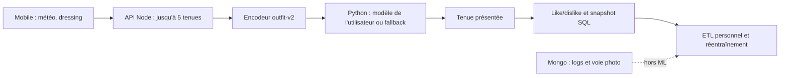
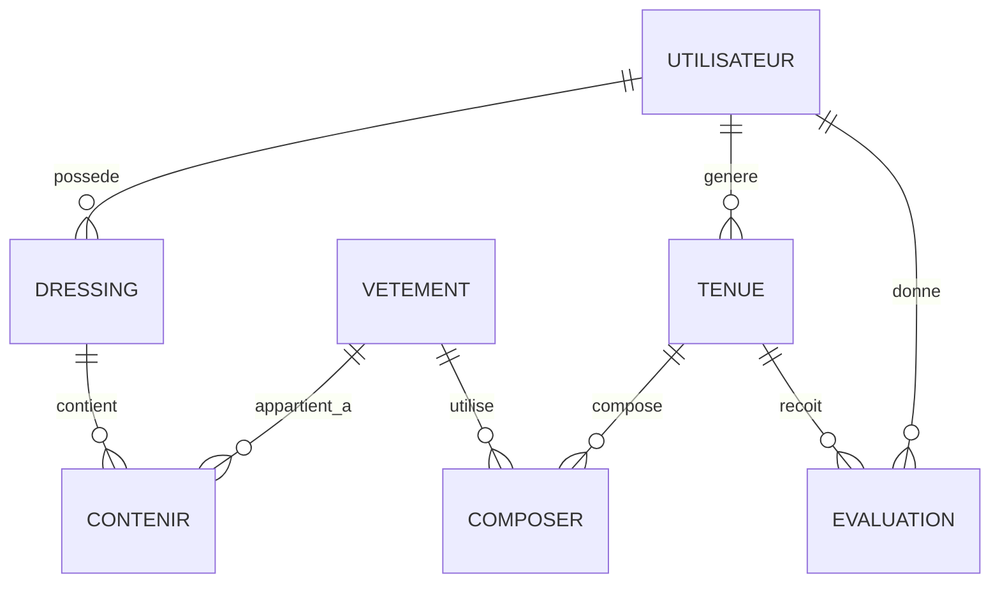

# FITS — État actuel et preuves RNCP Big Data & IA

**Photographie du 13 octobre 2026.** Ce document remplace les audits, plans et rapports intermédiaires du dossier RNCP. Les chiffres ci-dessous sont des mesures locales datées, pas des performances de production. Ils ne doivent pas être actualisés sans nouvelle mesure reproductible. Le [REX individuel](DOSSIER_REX_E7B.md) est le livrable à personnaliser ; le [guide de préparation](PREPARATION_SOUTENANCE.md) contient la démo, le protocole utilisateur et la trame orale. Les anciens documents retirés restent consultables dans l'historique Git.

La grille Excel RNCP40573 fournie par le candidat est celle validée par son professeur. Elle demande cinq décisions **VALIDE / NON VALIDE**, sans barème officiel sur 20. Son libellé BC04B, sa mention BC04A en B102 et la fiche publique BC05 divergent : confirmer le code à afficher auprès du responsable de session. Le projet a été défini par le candidat ; aucun commanditaire ni retour utilisateur explicite n'a encore été recueilli.

## Parcours et architecture réellement implémentés

Le mobile attend l'enregistrement du dislike avant de régénérer et bloque les clics multiples. Le backend vérifie la propriété de la tenue et capture les caractéristiques au moment des nouveaux avis. Avant le score ML, `backend/services/outfitCandidate.js` limite les couches par temps doux, écarte les manteaux lourds au-dessus de 12 °C, supprime la couche extérieure à partir de 20 °C, rend les accessoires facultatifs et privilégie au plus deux couleurs vives distinctes lorsque le dressing permet un choix. Ce sont des **heuristiques initiales de composition**, non des préférences apprises ou des seuils validés empiriquement. L'identité du modèle vient du JWT côté Node ; Python exige le secret interne commun, valide la version et les colonnes, puis conserve un Joblib par utilisateur. L'entraînement requiert par défaut **20 avis, dont cinq de chaque classe** : ce seuil évite les jeux manifestement insuffisants, sans garantir un modèle utile. Sans modèle compatible, la prédiction renvoie explicitement `fallback` avec le ratio de favoris ; un échec d'entraînement ne remplace pas le modèle valide. Tests isolés : `backend/tests/outfitCandidate.test.js`, `mlJourney.integration.test.js`, `ml-service/tests/test_app.py` et `ml-service/demo_isolated.py`. La démo synthétique prouve le fonctionnement, pas la qualité prédictive.

## C1 — Besoin, sources et 3V

**Hypothèse de besoin :** choisir une tenue compatible avec la température et le dressing, puis tenir compte des likes/dislikes. Le projet est un prototype local ; ni demande externe ni effet métier mesuré ne sont revendiqués.

| Mesure locale du 13/10/2026 | Valeur | Portée |
|---|---:|---|
| PostgreSQL `fits` sur le Mac : utilisateurs / vêtements / tenues / compositions / avis | 6 / 22 / 271 / 1 709 / 69 | Base entière : 9,38 Mio ; 10 tables métier : 624 Kio |
| MongoDB distant `fits` : logs / photos | 233 / 1 | Statut de l'environnement distant non confirmé ; hors ML |
| Images dans `backend/uploads` suivies par Git | 17 | 20 120 Kio alloués sur ce Mac |
| Préparation de 64 lignes ML, 3 lectures | médiane 16,367 ms | Catalogue et Node ; hors entraînement, HTTP et export |
| Prédiction Python personnalisée, 5 lectures | médiane 5,859 ms | Fonction avec chargement Joblib ; hors HTTP et génération |

**Volume :** quelques centaines de lignes métier et des images plus lourdes que les tables ; aucun volume massif. **Vélocité :** 69 avis répartis sur huit jours actifs, jusqu'à 27 sur un jour observé ; aucun débit continu mesuré. **Variété :** relations SQL, snapshot JSONB, documents Mongo, images et météo JSON, dont seuls les avis/attributs vestimentaires alimentent le RF. Si l'usage croît, mesurer d'abord tailles, latence complète et erreurs ; paginer, indexer ou découpler l'entraînement seulement lorsqu'une mesure le justifie. Kafka/Spark/Hadoop n'ont pas de justification observée. Reproduction agrégée, sans écriture : `backend/scripts/diagnosePostgres.js` et `backend/scripts/diagnoseMongo.js` (ce dernier interroge la base Mongo distante).

## C2 — Modèle, données et performance mesurée

L'encodeur `outfit-v2` produit **85 caractéristiques** : 4 globales, 9 zones, 42 couleurs, 10 catégories, 18 sous-catégories et 2 associations. Les deux associations actuelles indiquent seulement « même couleur » et « neutre avec couleur » pour haut/bas ; elles ne codent **pas** une paire précise comme marron/noir ou rouge/jaune. Le nouveau sélecteur mobile impose une **couleur principale** parmi 12 valeurs ; l'API la canonise, tandis que l'encodeur continue de lire les anciennes couleurs libres. Ni l'ordre ni la version des 85 colonnes n'ont changé. Sur les 64 avis historiques exploitables, **64 colonnes sont constantes** ; les 21 autres ne constituent que 17 profils de colonnes distincts, avec des redondances. Une feature variable n'est pas pour autant prédictive. Parmi les 64 tenues évaluées, il n'y a que **29 vecteurs de features distincts** ; 11 vecteurs identiques portent les deux labels. La représentation ne sépare donc pas tous les avis observés.

Les **69 avis bruts** proviennent d'un seul compte : 44 likes et 25 dislikes. Cinq températures manquantes sont exclues ; **64 lignes ML** restent, avec **42 likes et 22 dislikes**. Seuls **3/69 avis** ont un snapshot valide ; les 66 autres peuvent être reconstruits avec l'état *actuel* des vêtements. **Le candidat précise désormais avoir attribué une partie des anciens likes/dislikes de façon assez aléatoire.** La proportion exacte n'est pas connue : ces chiffres vérifient le pipeline sur les avis historiques mais ne permettent pas de juger fidèlement l'apprentissage de ses préférences. Aucun avis synthétique n'entre dans les mesures ci-dessous.

`ml-service/evaluate_robust.py` a produit **30 séparations groupées admissibles** avec `StratifiedGroupKFold` à quatre plis et des graines à partir de 42. Une même tenue ou un vecteur identique ne traverse pas entraînement et test. Les modèles sont ajustés uniquement sur la partie entraînement : RF identique à `/train` (`random_state=42`), `DummyClassifier` majoritaire, régression logistique L2 standardisée. Le like est positif. Les splits **se recouvrent** : les écarts-types ci-dessous décrivent leur variabilité, pas des intervalles de confiance indépendants.

| Modèle hors ligne | Accuracy | Balanced accuracy | Précision like | Rappel like | F1 like | ROC AUC | Average precision |
|---|---:|---:|---:|---:|---:|---:|---:|
| RF, 85 features | **0,582 ± 0,073** | 0,467 ± 0,045 | 0,619 ± 0,059 | 0,901 ± 0,135 | 0,728 ± 0,066 | 0,402 ± 0,088 | 0,604 ± 0,074 |
| Majorité de l'entraînement | **0,638 ± 0,059** | 0,500 ± 0,000 | 0,638 ± 0,059 | 1,000 ± 0,000 | 0,777 ± 0,045 | 0,500 ± 0,000 | 0,638 ± 0,059 |
| Régression logistique exploratoire | 0,573 ± 0,105 | 0,468 ± 0,053 | 0,613 ± 0,085 | 0,825 ± 0,232 | 0,692 ± 0,136 | 0,436 ± 0,081 | 0,623 ± 0,071 |

Le RF n'a dépassé la majorité en accuracy sur **aucun des 30 splits appariés**. Une expérience distincte, sur les **mêmes 64 avis** et quatre plis groupés fixés, a comparé RF85, RF avec quatre variables globales et baseline : accuracy moyenne **0,517 / 0,609 / 0,670** ; ROC AUC pondérée par paires **0,358 / 0,485 / 0,500**. Cette ablation suggère que les indicateurs supplémentaires n'aident pas *sur cet échantillon* ; elle ne valide aucune autre variante ni un changement de production. Les plis inégaux, les vêtements partagés entre tenues, les votes parfois aléatoires et surtout les 66 snapshots manquants limitent fortement l'interprétation. Le groupe par tenue/vecteur élimine les doublons exacts entre train et test, **pas toutes les fuites possibles**.

Le backend ne conserve ni le lot complet des cinq candidats et leurs scores, ni des jugements sur les candidats non retenus. ROC AUC/AP sur les avis exposés ne mesurent donc pas le classement d'un lot : **NDCG@5 et gain métier non mesurables honnêtement**. Le RF reste une référence expérimentale utilisée lorsqu'un modèle compatible existe ; il n'y a pas de garde-fou le comparant à la baseline en production. Aucune modification du RF ou des Joblib n'est justifiée avant l'oral.

## C3 — ETL, qualité et protection des données

**Extraction :** avis et compositions du seul utilisateur concerné. **Contrôles :** propriétaire de la tenue, température entière/cohérente, booléen, composition complète, snapshot versionné. **Transformation :** snapshot figé si présent, sinon attributs courants ; normalisation en colonnes `outfit-v2`. **Chargement :** envoi des lignes numériques et labels à `/train` avec l'identité authentifiée. Les cinq avis sans température sont exclus sans imputation ; aucun ancien snapshot n'a été inventé. Les nouveaux votes dont le snapshot échoue sont refusés sans enregistrer l'avis. Scripts de preuve : `backend/scripts/reportEvaluationQuality.js` (agrégats en lecture seule) et `backend/scripts/exportEvaluationDataset.js` (export privé hors Git, garde-fous sur la base locale).

L'inscription publique impose le rôle `user`. Les uploads sont authentifiés, limités à 5 Mio, à JPEG/PNG/WebP et à une signature initiale cohérente ; les noms nouveaux sont des UUID. Les nouvelles couleurs sont choisies dans une palette contrôlée, sans migration ni changement des anciennes valeurs ; cela évite de nouveaux libellés ambigus mais ne reconstitue pas l'historique. Les nouveaux logs d'authentification n'ajoutent plus e-mail/IP ; la voie photo Mongo vérifie le propriétaire à la lecture. **Limites :** anciens logs potentiellement plus détaillés, anciennes photos Mongo sans propriétaire refusées, `/uploads` disque public, anciennes images suivies par Git, URL d'upload basée sur `Host`, absence de suppression coordonnée des logs/photos/images/Joblib après suppression SQL. Aucune durée de conservation appliquée ni conformité RGPD/PSH/SLA ne sont démontrées. Une suppression transversale demande attribution fiable, politique de rétention, sauvegardes et tests isolés ; ne pas la déclencher sur les données actuelles.

## C4 — Conception et mesure des stockages

PostgreSQL porte les FK, transactions et clés composées, dont `evaluation(id_utilisateur,id_tenue)` ; `feature_snapshot` est un JSONB nullable déjà présent dans la base locale mesurée. Le contrôleur, et non les seules FK, vérifie l'appartenance de la tenue à l'utilisateur. SQL n'impose ni l'unicité d'un dressing par utilisateur ni l'appartenance de tous les vêtements d'une composition au même compte. Trois nullabilités SQL diffèrent des modèles Sequelize (`evaluation.temperature`, `tenue.temperature`, `vetement.id_sous_categorie`).

Sur cinq `EXPLAIN ANALYZE` de lectures `SELECT` en transaction **READ ONLY**, médianes côté serveur : avis par utilisateur **0,017 ms**, tenues **0,049 ms**, dressing **0,005 ms**, vêtements d'un dressing **0,031 ms**, vêtements d'une tenue **0,007 ms**. À 69 ou 271 lignes, les scans séquentiels observés sont plausibles ; ces temps ne couvrent ni réseau, ORM, API ni génération complète. Aucun gain d'index n'a été mesuré. MongoDB héberge 233 logs et une photo, sans alimenter le ML ; son bénéfice face à la complexité de deux stockages n'est pas prouvé. Aucun index secondaire Mongo ni TTL observé. Ne pas ajouter index ou migration avant une mesure sur copie isolée.

## C5 — Intégration, démonstration et limites

Le parcours génération → filtrage de cohérence → score par candidat → vote → snapshot → ETL → modèle personnel/fallback est couvert par tests isolés. Les réponses `model_used: personalized` et `fallback/no_model` sont montrables via la démo synthétique. Le correctif de composition évite l'empilement manifeste à 22 °C dans les tests fictifs. Une simulation **en lecture seule** sur le dressing de développement le plus fourni a produit 200/200 tenues valides à 22 °C, sans couche extérieure ni double couche de torse ; c'est un contrôle fonctionnel local, **pas** une mesure de confort ou de gain du RF. La génération complète, le réentraînement synchrone après vote et jusqu'à cinq appels ML séquentiels ne disposent pas de temps bout en bout ni de P95 mesuré ; `mlClient.js` n'a pas de timeout Axios. Le mobile pointe encore vers une adresse IP LAN fixe ; un autre réseau nécessite de mettre à jour sa configuration. Le correctif de résolution des anciennes URL d'images dépend de cette même adresse ; certains liens `file://` et fichiers manquants ne peuvent pas être restaurés automatiquement. Préparer une démo locale vérifiée et une sortie de secours isolée.

## Décisions avant l'oral et travaux ultérieurs

| Priorité | Maintenant | Après l'oral, si besoin mesuré |
|---|---|---|
| Preuve utilisateur | Faire tester 2–3 volontaires, comptes distincts, consigner réussites/incidents/retours anonymisés ; ne pas les présenter comme performance ML | Collecter davantage d'avis diversifiés avec snapshots et un protocole de classement de candidats fixé à l'avance |
| Démo | Vérifier réseau/adresse du Mac, images, secret de service et parcours ; garder la démo synthétique isolée en secours | Configurer une origine API stable et migrer progressivement les références d'images |
| Modèle | Montrer RF **sous** baseline et le fallback ; conserver RF/Joblib | N'envisager une promotion qu'avec données et test indépendant démontrant un gain |
| Couleurs | Sélecteur d'une couleur principale, filtre souple des couleurs vives ; ne pas prétendre apprendre les paires précises | Une seconde couleur par vêtement et des préférences de paires demandent un contrat de données, un snapshot et des features versionnés, puis une évaluation sur de nouveaux avis fiables |
| Données/sécurité | Expliquer honnêtement le cycle de vie incomplet et la lecture publique des images disque | Définir rétention, accès aux images, effacement inter-stockages et tests de suppression |
| Infrastructure | Garder l'architecture proportionnée ; aucune migration/index/stack distribuée maintenant | Mesurer latence complète, charge et coûts avant optimisation |

**Preuves reproductibles :** tests sous `backend/tests`, `mobile/tests` et `ml-service/tests`; diagnostics agrégés sous `backend/scripts`; évaluations hors ligne `ml-service/evaluate.py`, `evaluate_robust.py` et `audit_final_ml.py`. Le test `backend/tests/fits.test.js` écrit dans la base de développement et **ne doit pas** faire partie d'une commande de tests sûrs. Les mesures ci-dessus ne sont pas une validation externe et peuvent changer lorsque les données ou vêtements changent.
