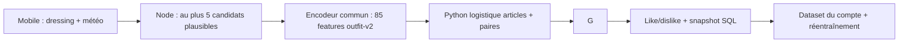

# FITS — État actuel du projet et preuves RNCP bloc 4

**Révision documentaire : 21 octobre 2026.** Cette fiche décrit le code de `main` et les derniers relevés disponibles. Les mesures portent sur des dates et populations différentes ; aucun nouveau relevé SQL n'a été obtenu pendant cette révision. Les preuves détaillées sont [C1](preuves/C1_BESOIN.md), [C2](preuves/C2_MODELE.md), [C3](preuves/C3_DONNEES.md), [C4](preuves/C4_STOCKAGE.md) et [C5](preuves/C5_PROGRAMME.md). Le [guide de préparation](PREPARATION_SOUTENANCE.md) rassemble le protocole, les commandes et la trame orale.

La grille Excel **RNCP40573** fournie par le candidat a été validée par son professeur. Elle attend cinq décisions « valide / non valide », sans note officielle sur 20. Les libellés BC04B/BC04A du classeur et BC05 de la fiche publique divergent : vérifier le code à afficher auprès de l'établissement. Les fiches documentent des preuves, elles ne préjugent pas de la décision du jury.

## Synthèse des cinq axes

| Axe | Acquis vérifiable | Limite décisive |
|---|---|---|
| **C1 — besoin et 3V** | Besoin personnel formulé : gagner du temps, trouver des associations et revoir des vêtements oubliés ; sources et indicateurs définis. | Aucun retour indépendant de volontaire ; temps de choix auto-estimé, non chronométré. |
| **C2 — modèle et mesure** | Articles/paires personnel utilisé normalement par tous les comptes, RF conservé comme comparateur historique, baseline et évaluations hors ligne avec séparation et purge. | Taux de likes des sessions non causal ; avantage de classement sur cinq candidats et généralisation non démontrés. |
| **C3 — ETL et protection** | Snapshots versionnés, contrôle de qualité, accès privés, suppression/reprise et tests isolés multi-stockages. | Historique incomplet, sauvegardes réelles et rétention à opérer ; aucune conformité RGPD complète revendiquée. |
| **C4 — stockage** | Relations SQL et JSONB justifiés, plans en lecture seule et benchmark d'index sur données fictives. | Charge réelle trop faible pour justifier une migration ; latence globale et coût d'écriture non mesurés. |
| **C5 — programme IA** | Parcours mobile → Node → Python → vote testé ; modèles personnels, fallback, panne et isolation vérifiés. | Vérification finale sur l'iPhone et sur le réseau de l'oral encore nécessaire ; tests techniques ≠ performance métier. |

## Produit et architecture en place

Le mobile a été refondu : accueil et météo plus lisibles, états de chargement/erreur, dressing avec recherche, filtres, tri et favoris, formulaire d'ajout/modification avec palette contrôlée et **estimation thermique par catégorie ajustable**, profil avec édition et suppression confirmée. L'API reprend l'hôte LAN d'Expo ou `EXPO_PUBLIC_API_URL`. Le service reste local ; changer de réseau exige une vérification depuis l'appareil. [Écrans](../../mobile/src/screens/) ; [tests mobile](../../mobile/tests/).

Le générateur applique des règles de couches, température, couleurs simples et accessoires ; une chemise seule à 9 °C et des lunettes sans soleil étaient des problèmes signalés par le candidat. Les règles améliorent les **candidats**, sans être une preuve d'amélioration du ML. La génération demeure variée. Le vote porte sur la tenue entière ; un seul dislike ne révèle pas l'article responsable. La collecte attend l'enregistrement avant de proposer une autre tenue et empêche les doubles appuis.

Node tire l'identité du JWT et l'envoie au service Python avec un secret interne. Chaque compte dispose de son modèle. L'entraînement courant exige au minimum **20 avis avec snapshot v2 dont cinq par classe** ; en dessous, le modèle valide existant est conservé et l'absence de modèle donne un fallback explicite fondé sur le ratio de favoris. Ce seuil est opérationnel, **pas** un seuil de fiabilité prédictive. Les 85 features et les Joblib RF de référence n'ont pas été remplacés.

Depuis le basculement demandé le 21/10, `items-pairs-v1` est le **modèle normal de tous les comptes**. Le nom de fichier `experimental_app.py` et la variable `ML_EXPERIMENTAL_URL` sont historiques ; `ML_EXPERIMENTAL_USER_ID` est ignoré. Le service Python distinct et un dossier privé distinct conservent ses modèles. Sur ce Mac, le modèle du compte de test a été copié de `/private/tmp` vers le stockage privé persistant par défaut `~/.fits/models/items-pairs-v1`, sans écraser l'original ; les deux fichiers sont identiques. Il réutilise les 85 caractéristiques générales, puis ajoute les identités d'articles et paires de **snapshots v2** dans une régression logistique L2. L'application cliente ne choisit pas de modèle. Le RF ne classe plus les tenues ; son service est maintenu pour les anciens Joblib et leur suppression. Une panne ou un modèle manquant donnent le fallback explicite, sans substitution silencieuse du RF. [Démarrage et limites](../../ml-service/README.md#modele-articlespaires-par-defaut).

## C1 — Besoin et sources

Le candidat a conçu FITS pour gagner du temps le matin et explorer son dressing. Dans un auto-essai, il **estime** environ 5 min sans FITS et 30 s avec FITS pour trouver une tenue acceptable à la troisième suggestion ; trois des cinq premières lui plaisaient. Il n'a pas chronométré cette comparaison, n'a pas encore porté une tenue *après* l'avoir découverte dans FITS, et signale la saisie du dressing comme principale friction. Les photos de vêtements précédemment proposés sur Vinted lui ont fait envisager de nouvelles associations pendant ses essais. Ce récit ne remplace pas des retours de volontaires. [Protocole préparé](PREPARATION_SOUTENANCE.md#essais-de-volontaires).

**3V proportionnés :** quelques centaines de tenues/avis dans le dernier relevé complet daté du 13/10, saisie et votes manuels sans débit continu mesuré, formats SQL/JSONB, météo JSON, journaux Mongo et photos. Aucun volume massif Big Data n'est revendiqué. La stratégie consiste à mesurer usage, latence, erreurs et coût de saisie avant de complexifier l'infrastructure.

## C2 — Modèle et résultats à annoncer

L'encodeur `outfit-v2` comporte **85 colonnes** : quatre globales, neuf zones, 42 couleurs, dix catégories, 18 sous-catégories et deux associations générales. Sur les **64 avis historiques exploitables**, 64 colonnes étaient constantes et seulement **29 vecteurs distincts** existaient ; 11 vecteurs identiques portaient les deux labels. Ces constats concernent cette ancienne cohorte, pas nécessairement les nouveaux avis. Les 69 avis bruts initiaux incluaient cinq températures manquantes et 66 snapshots absents ; le candidat dit avoir voté parfois assez aléatoirement à cette époque.

| Relevé réel | Méthode | Résultat et lecture |
|---|---|---|
| Ancien compte, 64 avis utilisables | 30 séparations groupées recouvrantes | Accuracy RF **0,582 ± 0,073**, majorité **0,638 ± 0,059** ; RF meilleur 0/30. [Visuel daté](visuels/accuracy_rf_baseline.png). |
| Compte récent, relevé initial de 100 avis à 19 °C | Même famille de séparations groupées | RF **0,624 ± 0,090**, majorité **0,659 ± 0,065** ; RF meilleur 4/30. |
| Compte récent, 21/10 : 62 avis matin à 11 °C puis 97 après-midi/soir à 15 °C | Comparaison descriptive des sessions sous les versions **déclarées** par le candidat | **25/62 = 40,3 %** de likes puis **64/97 = 66,0 %**. Écart **25,7 points**, sans attribution causale au modèle : météo et apprentissage évoluent, variante non mémorisée par avis. |
| Compte récent, 251 snapshots v2 disponibles le 21/10 | Test chronologique hors ligne, après purge : 182 train, 63 test, six exclus ; test à 15 °C avec 49 likes/14 dislikes | Accuracy majorité **0,222**, RF v2 **0,286**, RF+articles **0,413**, RF+articles+paires **0,429**, logistique articles+paires **0,429** ; AUC RF **0,386**, logistique **0,640**. Ce découpage unique déjà exploré n'est pas une validation indépendante. |

Les modèles hors ligne sont ajustés sur le train seulement ; le vocabulaire articles/paires y est appris. La purge sépare tenues, compositions et vecteurs identiques, mais le partage d'articles laisse des dépendances. Les splits recouvrants produisent des **écarts-types descriptifs**, pas des intervalles de confiance. Seule la tenue affichée est évaluée : AUC sur ces avis n'est pas une mesure du classement des cinq candidats, et NDCG@5 n'est pas calculable honnêtement. **Conclusion C2 : le modèle articles/paires fonctionne et le signal récent est intéressant ; sa généralisation et son avantage prédictif ne sont pas démontrés. Le rendre normal est un choix produit, pas une conclusion statistique.** [Méthode et données séparées](preuves/C2_MODELE.md).

## C3 — ETL et cycle de vie

Le backend vérifie propriété de la tenue, booléen, température, composition et snapshot. Il fige les attributs et identifiants des nouveaux avis ; l'ETL prépare le dataset du seul utilisateur, normalise `outfit-v2` et transmet les labels à Python. Les cinq températures manquantes de l'ancien relevé sont exclues sans imputation ; les 66 anciens avis sans snapshot peuvent refléter l'état **actuel** des vêtements. Un relevé ultérieur du 21/10 portait sur **251 snapshots v2 du compte récent** pour l'analyse d'interactions ; ce nombre n'est pas le total SQL. Aucune donnée historique n'a été modifiée pour établir ces preuves. [Script agrégé en lecture seule](../../backend/scripts/reportEvaluationQuality.js).

Inscription publique limitée au rôle `user`, uploads et images authentifiés, vérification du propriétaire et modèles séparés. Le profil permet de supprimer son compte : SQL, MongoDB, images attribuables et Joblib personnels sont coordonnés ; `202` signifie qu'une reprise est nécessaire. Les tests utilisent PostgreSQL/Mongo/FastAPI et répertoires **temporaires**, y compris panne et restauration SQL. Sur les données réelles, les anciens fichiers non attribuables, certaines références manquantes, les images suivies dans Git et les anciennes sauvegardes restent des limites. La rétention proposée de 30 jours pour logs et sauvegardes privées n'est pas une purge périodique effectivement opérée. Aucune conformité RGPD complète n'est revendiquée. [Détails C3](preuves/C3_DONNEES.md).

## C4 — Stockage et performance

PostgreSQL relie utilisateur, dressing, vêtement, tenue, composition et évaluation ; `feature_snapshot` est un JSONB versionné. La clé composée des évaluations sert déjà à lire les avis d'un compte. MongoDB héberge des logs et une voie photo, sans alimenter le ML. La complexité de deux stockages est reconnue. Des écarts de nullabilité et de contraintes entre SQL et Sequelize sont documentés ; aucune migration n'est engagée.

**Relevé SQL daté du 13/10 :** six utilisateurs, 57 vêtements, 385 tenues, 2 210 compositions et 171 avis. Les médianes serveur en transaction `READ ONLY` étaient 0,044 ms pour les tenues par compte et 0,020 ms pour ses avis ; elles excluent HTTP, ORM, réseau et concurrence. Le benchmark sur un PostgreSQL isolé avec **100 000 tenues fictives** a mesuré la même requête utilisateur à **2,081 ms sans index** puis **0,139 ms avec index B-tree**, au coût de **728 Kio** de stockage. [Données/plans](benchmark_stockage_synthetique.json) ; [visuel synthétique](visuels/stockage_synthetique.svg). Aucune donnée réelle ou migration n'a servi à ce benchmark. Il ne justifie pas encore cet index dans la petite base réelle.

## C5 — Programme et validation technique

Le parcours génération → classement personnel/fallback → avis → snapshot → dataset → réentraînement est couvert par des tests Node, Python et mobile. Le lanceur d'intégration démarre de **vrais PostgreSQL, MongoDB et FastAPI temporaires**, sans viser les données applicatives. Les tests vérifient 85 colonnes cohérentes, deux utilisateurs isolés, avis persistant, panne/fallback et absence de remplacement d'un modèle valide après échec. L'intégration du modèle courant relie Node au vrai Python articles/paires avec données fictives. [Scénario](preuves/C5_PROGRAMME.md).

Vérification **après basculement** le 21/10 : **179 tests backend, 51 Python, 63 mobile et six scénarios isolés** avec PostgreSQL, MongoDB et deux FastAPI temporaires réussis. Le lint mobile, les exports Expo web/iOS et un parcours visuel web fictif avaient réussi avant le basculement, sans changement des écrans depuis. Un ancien essai mobile sous Node 24 a subi un crash V8 non reproduit lors de la suite complète. Les tests n'établissent ni SLA, ni qualité prédictive, ni rendu iPhone complet. Un problème de cache Metro a été soupçonné après des erreurs `TYPE.eyebrow/caption` ; le thème et l'usage de `SafeAreaView` de `react-native-safe-area-context` sont présents dans le code actuel, et la compilation fraîche avait réussi. **La relance sur appareil réel reste à confirmer.**

## Décisions avant l'oral

1. **Geler les fonctionnalités et les modèles.** Présenter articles/paires comme modèle courant pour tous les comptes et le RF comme comparateur historique ; ne pas présenter le taux de likes comme accuracy.
2. **Réaliser si possible 2–3 essais utilisateurs honnêtes**, avec protocole déjà préparé, ou annoncer leur absence. Ne pas mélanger leurs avis avec les anciens comptes.
3. **Répéter une fois le parcours sur le réseau et l'iPhone de l'oral** : connexion, images privées, dressing, génération, vote, score articles/paires ou fallback, suppression sur compte fictif uniquement si prévue. Préparer la démo synthétique isolée comme secours.
4. **Conserver les limites explicites** : classement des candidats non jugés non mesuré, petit jeu dépendant de la météo, sauvegardes/ancien historique à traiter, benchmark C4 fictif. Aucune migration, purge ou promotion automatique n'est nécessaire avant la soutenance.
