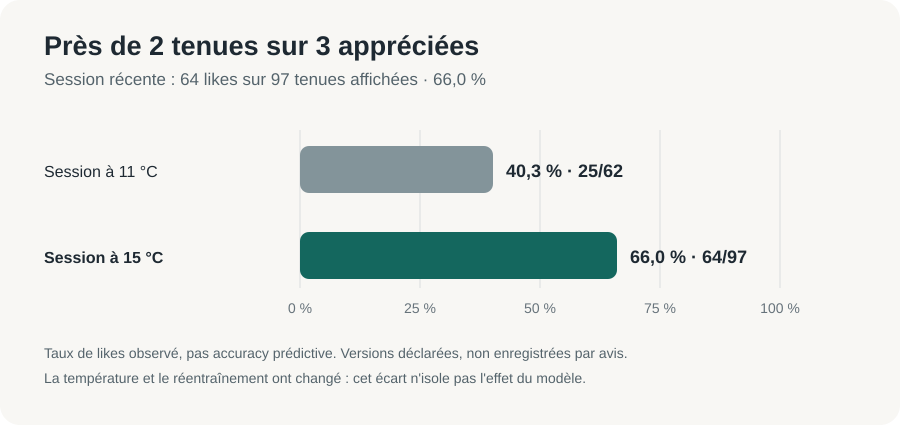
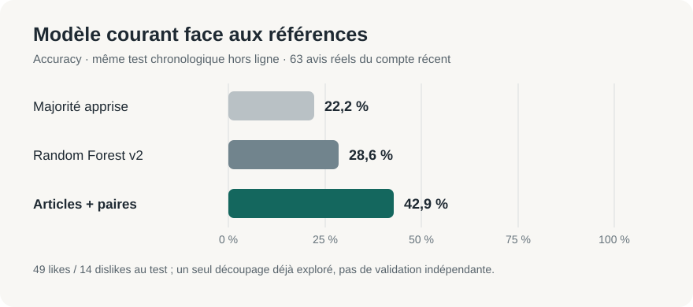

# C2 — Modèles, évaluation et limites

## Évolution à raconter dans le PowerPoint

| Étape | Problème constaté et changement réalisé | Preuve ou limite à annoncer |
|---|---|---|
| Départ : Random Forest `outfit-v2` | Les **85 caractéristiques** décrivaient surtout la météo et les propriétés globales de la tenue, sans identifier directement le jean, le manteau ou leur association. Le modèle, initialement partagé, a ensuite été isolé par utilisateur avec fallback si les avis étaient insuffisants. | Sur l'ancien compte, 64 avis exploitables : RF **58,2 %** d'accuracy moyenne contre **63,8 %** pour la majorité sur 30 séparations groupées recouvrantes. Avis parfois aléatoires et seulement 29 vecteurs distincts : ce résultat décrit cette ancienne cohorte, après isolation des modèles. |
| Données plus fiables | Le vote like/dislike, la propriété de la tenue et le snapshot au moment de l'avis ont été fiabilisés. Le snapshot v2 conserve aussi les **identifiants des vêtements** pour éviter de perdre l'association évaluée lorsque le dressing évolue. | Le modèle actuel exige des snapshots v2 ; les anciens avis incomplets ne deviennent pas rétroactivement des exemples fiables d'associations. |
| Modèle courant : articles et paires | Une **régression logistique L2 par utilisateur** reçoit les 85 caractéristiques générales **plus** les identités des vêtements et leurs paires. Le RF reste un comparateur hors ligne ; le service courant classe jusqu'à cinq candidats et le fallback reste explicite. | Sur **le même test chronologique hors ligne de 63 avis**, accuracy **42,9 %** pour le modèle courant contre **28,6 %** pour le RF v2 et **22,2 %** pour la majorité apprise sur l'entraînement. C'est un résultat de ce test, pas une précision générale garantie. |
| Génération plus cohérente, sans changer le modèle | Les filtres de météo/couleurs encadrent les candidats avant le score. Le 22/10, la règle thermique des couches extérieures a été assouplie : un vêtement limité à 12 °C peut être proposé jusqu'à **18 °C au maximum** (marge de six degrés) ; une veste ou un manteau reste facultatif, et la proposition ne montre qu'un haut dessous. | À 13 °C, le premier relevé prospectif comportait **0/25** tenue avec couche extérieure ; le suivant **39/70**, dont **8 manteaux épais anciennement limités à 12 °C**. Cette évolution concerne **les candidats proposés**, pas l'algorithme de régression. |
| Mesure après affichage | La prédiction de la tenue effectivement montrée est journalisée **avant le vote**, puis rapprochée de l'avis réel. | Sur les **70 nouveaux avis** à 13 °C : **35/70 tenues aimées**, modèle correct sur **38/70**, majorité fondée sur les avis antérieurs correcte sur **35/70**. Trois bonnes réponses d'écart sont encourageantes mais ne démontrent pas un avantage prédictif fiable. |

**Message juste pour le jury :** FITS est passé d'un RF fondé surtout sur des propriétés globales à un modèle personnel capable de représenter les vêtements et leurs paires ; il propose désormais aussi des couches extérieures auparavant exclues à 13 °C. Les preuves montrent un pipeline fonctionnel et une amélioration sur **un test hors ligne commun**. La qualité prédictive en usage réel et le classement des cinq candidats restent à confirmer. Ne pas confondre le **taux de tenues aimées** avec l'**accuracy** des votes prédits, ni attribuer au seul modèle un changement de taux de likes après une modification du générateur.

## Ce qui fonctionne aujourd'hui

Le générateur produit jusqu'à cinq tenues admissibles ; le score choisit celle qui sera montrée. L'encodeur commun [outfitFeatures.js](../../../backend/services/outfitFeatures.js) fournit **85 caractéristiques `outfit-v2`**. Le modèle **normal** est désormais le service [articles/paires](../../../ml-service/experimental_app.py) pour **tous les comptes**. Son nom de fichier est historique : Node y envoie les identifiants d'articles et leurs paires issus des snapshots v2, puis le service applique une régression logistique L2 par utilisateur. `ML_EXPERIMENTAL_USER_ID` n'est plus utilisé ; `ML_EXPERIMENTAL_URL` reste le nom technique du port local 8001. Le [Random Forest](../../../ml-service/app.py) reste la référence **hors ligne** et ses Joblib sont conservés séparément, sans être utilisés pour classer les tenues normales. Le mobile ne choisit jamais le modèle d'un autre utilisateur. [Démarrage et garde-fous](../../../ml-service/README.md#modele-articlespaires-par-defaut).

Un vote juge la **tenue entière**. Même avec des indicateurs de paires, un seul dislike n'établit pas quel article ou quelle association a déplu. Le modèle peut pondérer des corrélations vues sur plusieurs tenues ; il ne déduit ni coupe, ni marque, ni causalité certaine. Les goûts peuvent évoluer. Le seuil technique de **20 avis avec snapshot v2, dont cinq par classe**, autorise l'entraînement mais ne prouve aucune qualité prédictive. Les anciens avis sans snapshot v2 ne suffisent donc pas à activer une personnalisation sur un compte historique. Sans modèle compatible ou en cas de panne, un fallback explicite utilise le ratio de favoris ; le service ne revient pas silencieusement au RF.

## Résultat d'usage : 66 % de tenues appréciées

Pendant la session récente du 21/10 à **15 °C**, le candidat a aimé **64 des 97 tenues affichées, soit 66,0 %**. Lors de la session précédente à **11 °C**, il en avait aimé **25 sur 62, soit 40,3 %**. Les **159 avis** et leurs températures ont été confirmés dans PostgreSQL local en lecture seule. Le candidat attribue ces sessions respectivement aux versions avant et après son essai du modèle articles/paires. Cela donne un **signal d'usage favorable de +25,7 points** et répond directement à la question « combien de suggestions m'ont plu ? ».

Ce taux concerne **un seul utilisateur** et les tenues effectivement affichées. Le changement de température, le réentraînement au fil des votes et l'absence de version enregistrée avec chaque avis empêchent d'attribuer avec certitude les +25,7 points au seul changement de modèle. Le taux de **75 % évoqué comme valeur provisoire** n'est pas confirmé sur cette série de 97 avis ; le chiffre final vérifiable est **66,0 %**.

## Évaluation prédictive hors ligne : modèle courant face au RF (relevé figé du 21/10)

Au relevé **du 21/10**, le compte récent totalisait **362 avis réels** (209 likes, 153 dislikes), dont **251 snapshots v2** utilisables pour l'étude des identités d'articles. Le relevé **du 22/10** compte désormais **457 avis**, dont **346 snapshots v2** ; les nouveaux avis n'ont **pas** été réinjectés dans le test historique suivant. Sur **le même découpage chronologique hors ligne** de 63 avis de test, après entraînement sur 182 avis et purge de six doublons potentiels, le modèle courant logistique articles/paires obtient **42,9 % d'accuracy**, contre **28,6 % pour le Random Forest `outfit-v2`** et **22,2 % pour la classe majoritaire apprise sur l'entraînement**. L'écart courant–RF est **+14,3 points sur ce test** ; l'AUC est **0,640 contre 0,386**. C'est une amélioration **observée sur ce protocole**, pas une promesse de performance future. Le jeu de test comporte 49 likes et 14 dislikes à 15 °C ; la majorité du jeu d'entraînement est inverse, ce qui explique en partie la faible baseline. **42,9 % n'est pas le pourcentage de tenues aimées** : c'est la proportion de votes correctement anticipés par un classifieur entraîné sur les avis précédents.

**Diagnostic des erreurs sur ces mêmes 63 avis de test (recalculé le 22/10, aucun nouvel avis) :** avec le seuil de classification du modèle courant, 18 likes et 9 dislikes sont correctement anticipés ; 31 likes sont prédits dislikes et 5 dislikes sont prédits likes. Les probabilités se concentrent entre 0,2 et 0,8 : 18 tenues dans 0,2–0,4 (11 likes observés), 36 dans 0,4–0,6 (29 likes), neuf dans 0,6–0,8 (neuf likes). Ce déplacement des avis du test vers les likes explique une grande partie des faux dislikes ; il **ne justifie pas** de changer le seuil après lecture de ce même jeu de test. Le script hors ligne affiche désormais ces agrégats pour un nouvel export, sans exposer les tenues individuelles.

## Autres mesures réelles et populations séparées

| Population et protocole | Résultat observé | Interprétation |
|---|---|---|
| Ancien compte : 69 avis bruts, 64 exploitables, 29 vecteurs distincts ; 30 séparations groupées recouvrantes | Accuracy RF **0,582 ± 0,073**, majorité **0,638 ± 0,059** ; RF supérieur dans 0/30 comparatifs | Votes parfois aléatoires, 66 snapshots manquants ; aucune preuve d'avantage du RF sur ce relevé. [Graphique historique](../visuels/accuracy_rf_baseline.png). |
| Compte récent, premier relevé de 100 avis tous à 19 °C ; même protocole groupé | RF **0,624 ± 0,090**, majorité **0,659 ± 0,065** ; RF supérieur dans 4/30 | Snapshots présents, mais une seule température. Relevé antérieur, non directement comparable à la session du 21/10. |
| 21/10, même compte et versions déclarées par le candidat : **25 likes/62** à 11 °C puis **64/97** à 15 °C | Taux de likes **40,3 %** puis **66,0 %**, soit **+25,7 points** | Comparaison descriptive détaillée ci-dessus, non causale. |
| 21/10, test chronologique hors ligne sur **251 snapshots v2** : 182 avis d'entraînement, 63 de test, six purgés ; test à 15 °C, 49 likes/14 dislikes | Accuracy majorité **0,222**, RF v2 **0,286**, RF+articles **0,413**, RF+articles+paires **0,429**, logistique articles+paires **0,429** ; AUC RF **0,386**, logistique **0,640** | Un seul découpage et un test déséquilibré, issu de données déjà explorées. Signal favorable à étudier, **pas validation indépendante** de la variante. |

Les 30 séparations recouvrantes et leurs écarts-types décrivent une variabilité, pas des intervalles de confiance. Dans le test chronologique récent, la majorité apprise sur l'entraînement prédit la classe négative, alors que **49/63 avis de test sont positifs** : son faible 0,222 reflète aussi ce changement de distribution. Les identités reconstruites des anciens avis via `composer` ne sont pas figées au moment du vote ; l'analyse la plus récente utilise `--snapshot-only`. Le script [evaluate_interactions.py](../../../ml-service/evaluate_interactions.py) purge de l'entraînement les mêmes tenues, compositions et vecteurs que le test, et apprend le vocabulaire seulement sur l'entraînement. Des articles peuvent néanmoins être partagés entre tenues : l'absence absolue de fuite n'est pas démontrée. L'évaluation est hors ligne et ne charge ni ne remplace les Joblib de l'application.

**Le classement des cinq candidats n'est pas mesuré** : seul le candidat affiché reçoit un avis. AUC sur les tenues affichées ≠ NDCG@5 ou gain de recommandation. Les 85 features incluent beaucoup de constantes et de redondances sur les petites cohortes ; des mesures supplémentaires et un protocole fixé avant de voir les résultats seraient nécessaires pour conclure.

**Première série prospective du 22/10 (même compte récent, distincte du test hors ligne ci-dessus) :** 27 prédictions personnalisées de tenues affichées ont été enregistrées avant la réponse au mobile ; 25 ont reçu ensuite un avis, deux attendent encore un vote. Les 25 avis sont tous à **13 °C** : 10 likes et 15 dislikes. Le modèle courant anticipe **11/25 avis (44 %)** contre **10/25 (40 %)** pour une majorité recalculée uniquement à partir des avis v2 antérieurs à chaque prédiction. L'écart d'un avis ne démontre aucun avantage fiable. Matrice du modèle : **4 vrais dislikes, 7 vrais likes, 11 faux likes et 3 faux dislikes**. Les scores se concentrent entre 0,4 et 0,8 ; sur les dix tenues notées entre 0,6 et 0,8, cinq seulement ont été likées. Ce petit relevé suggère des scores trop optimistes pour cette situation, sans suffire à mesurer une calibration générale ni justifier un réglage sur ces mêmes avis.

**Deuxième série prospective du 22/10, après le réglage des couches extérieures :** 70 nouvelles prédictions personnalisées ont été suivies de **70 avis**, toujours à **13 °C** : 35 likes et 35 dislikes. La prédiction du système était correcte sur **38/70 (54,3 %)**, contre **35/70 (50,0 %)** pour la majorité calculée uniquement à partir des avis antérieurs à chaque prédiction. Parmi les 70 tenues, **39** comportaient une couche extérieure et **22/39** ont été aimées ; parmi les **31** sans couche extérieure, **13/31** ont été aimées. **Huit** tenues montraient un manteau épais dont le maximum enregistré était 12 °C ; **cinq** ont été aimées. Aucune des 39 tenues avec couche extérieure ne cumulait plusieurs hauts dans le snapshot. Ces différences décrivent les tenues **sélectionnées et affichées** par un système qui se réentraîne après les votes ; elles ne sont ni un essai randomisé du générateur ni la preuve que le manteau cause un like. Le premier groupe de 25 avis avait **10/25 likes (40 %)** et aucune couche extérieure : l'écart avec les **35/70 (50 %)** du second groupe est suggestif, mais les tailles, les candidats disponibles et les révisions du modèle diffèrent.

**Cumul prospectif au 22/10 :** 97 prédictions personnalisées enregistrées, **95 votes appariés**, deux tenues sans avis ; 45 likes et 50 dislikes. Le modèle anticipe **49/95 (51,6 %)** votes, la majorité antérieure **45/95 (47,4 %)**. Cette baseline regarde uniquement les avis v2 **antérieurs à chaque prédiction** et prédit la classe alors majoritaire, sans examiner la tenue ; en cas d'égalité, elle prédit dislike. L'écart de quatre avis reste trop faible pour conclure à un gain général. Les deux séries sont séparées ici selon les **27 premières traces du relevé précédent**, puis les 70 nouvelles ; aucune étiquette de version du générateur n'était stockée dans la trace.

Le rapport en lecture seule `backend/scripts/reportProspectivePredictions.js ID_UTILISATEUR` reproduit les agrégats et exclut les prédictions postérieures au vote, les fallbacks et les tenues sans avis. Les avis historiques ci-dessus ne deviennent pas « prospectifs » rétroactivement. Le modèle a pu évoluer après chaque vote ; cette mesure concerne donc le système adaptatif utilisé, pas une version figée ni la qualité du classement des cinq candidats.

## Reproduction et décision

[Instructions d'export privé et d'évaluation](../../../ml-service/README.md#evaluation-hors-ligne-et-limites) ; [démonstration fictive du modèle courant](../../../ml-service/demo_interactions.py). Les exemples synthétiques vérifient le logiciel, jamais la performance réelle. Le choix de rendre articles/paires normal est une **décision produit du candidat**, pas une validation statistique. Le candidat décide désormais de **conserver ce modèle pour l'oral**. Une limite structurelle subsiste : la température et les identités d'articles entrent séparément dans la régression logistique, sans interaction explicite température × article ; les 95 votes prospectifs, tous à 13 °C, ne permettent pas d'évaluer une préférence thermique variable. Après l'oral, une variante ciblée pourrait être testée **hors ligne** sur des avis réels de températures différentes, puis comparée au modèle courant et à la baseline sur de nouvelles données. Pour l'oral, garder les cohortes et températures séparées, annoncer la majorité comme baseline et toutes les métriques, présenter le RF comme comparateur historique, et l'avantage prédictif général comme **non établi**. Ne pas régler le modèle sur les 95 avis déjà consultés pour annoncer ensuite leur score comme une validation indépendante.
